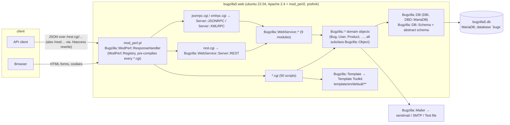
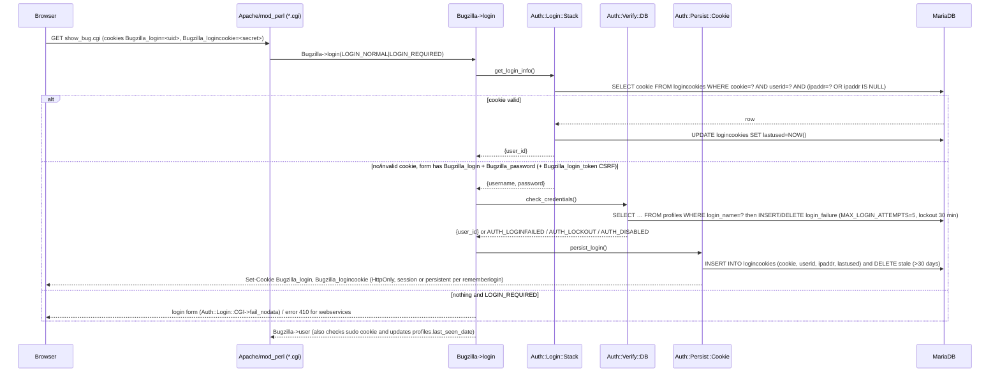

# Bugzilla 5.2 — system map for the Perl → Python migration

This document maps the Perl application as it runs today (branch `5.2`), so that
each migration slice can be scoped against real entry points, modules and
tables. Everything below was taken from the source tree and from the running
`docker compose` stack; line counts are `wc -l` of the current tree.

Companion document: [PLAN.md](PLAN.md).

## 1. Runtime topology

Key runtime facts:

* `docker/000-default.conf` does `PerlConfigRequire /var/www/html/mod_perl.pl`. `mod_perl.pl` adds
  `AddHandler perl-script .cgi` for the document root, pre-loads every `*.cgi` with
  `ModPerl::RegistryLoader`, loads extensions (`Bugzilla::Extension->load_all`) and installs
  `Apache2::SizeLimit` (45 MB unshared; in the container children recycle after ~2 requests).
* `Bugzilla.pm` is a process-wide singleton facade: `Bugzilla->dbh`, `->user`, `->cgi`,
  `->params` (from `data/params.json`), `->template`, `->request_cache`, `->usage_mode`
  (`USAGE_MODE_BROWSER | REST | JSON | XMLRPC | …`), `->switch_to_shadow_db`. `init_page()` runs
  per request and `_cleanup()` resets request state.
* `.htaccess` rewrites `rest/(.*)` → `rest.cgi/$1`, so both `/rest/bug/1` and `/rest.cgi/bug/1` work.
* Side effects on write paths: `Bugzilla::Bug->create/update` call `send_changes()` →
  `Bugzilla::BugMail::Send` → `Bugzilla::Mailer::MessageToMTA`. With `mail_delivery_method=Sendmail`
  and no sendmail binary in the image, `POST /rest.cgi/bug` returns HTTP 200 with
  `{"error":true,"code":100500,"message":"couldn't find a sendmail executable…"}` *after* the bug has
  been committed. The docker answers file now sets `mail_delivery_method=Test` (mail goes to
  `data/mailer.testfile`).
* Extensions (`extensions/*`) hook into 68 `Bugzilla::Hook::process(...)` call sites, including
  `webservice_before_call`, `webservice_fix_credentials`, `webservice_error_codes`,
  `webservice_status_code_map`, `bug_end_of_create`, `bug_end_of_update`. Only `BmpConvert`,
  `Example`, `MoreBugUrl`, `OldBugMove`, `Voting` ship in-tree; `Example` is disabled.

## 2. CGI entry points

All 50 scripts live in the repo root, are run under mod_perl and share the same bootstrap:
`use Bugzilla; my $cgi = Bugzilla->cgi; my $user = Bugzilla->login(...); my $template = Bugzilla->template; … $template->process(...)`.

| Group | Script | LOC | Purpose | Main modules |
| --- | --- | ---: | --- | --- |
| **API** | `rest.cgi` | 30 | REST dispatcher (`Bugzilla::WebService::Server::REST->new->handle`) | WebService::Server::REST |
| | `jsonrpc.cgi` | 31 | JSON-RPC 1.1 endpoint (same WebService modules) | WebService::Server::JSONRPC |
| | `xmlrpc.cgi` | 44 | XML-RPC endpoint (same WebService modules) | WebService::Server::XMLRPC |
| **Bug lifecycle** | `enter_bug.cgi` | 384 | Product chooser + new-bug form | Product, Component, Version, Milestone, Field, Group |
| | `post_bug.cgi` | 246 | Creates the bug from the form (`Bugzilla::Bug->create`) | Bug, Token, Attachment, Flag |
| | `show_bug.cgi` | 141 | Bug view (HTML/XML) | Bug, Keyword, Group |
| | `process_bug.cgi` | 446 | Bug edit submit (incl. mass change, mid-air collision check on `delta_ts`) | Bug, Token, Flag, Group |
| | `attachment.cgi` | 849 | View/create/edit attachments, patch diff/interdiff, flags | Attachment, Flag, FlagType, Token |
| | `show_activity.cgi` | 51 | Bug history | Bug |
| | `showdependencytree.cgi` | 150 | Dependency tree | Bug |
| | `showdependencygraph.cgi` | 353 | Graphviz dependency graph (`webdotbase`) | Bug |
| | `votes.cgi` | 40 | Redirect kept for the Voting extension | — |
| **Search / reports** | `query.cgi` | 328 | Simple/advanced search form | Search, Field, Product, Keyword |
| | `buglist.cgi` | 1165 | Executes searches: Boolean charts, quicksearch, saved queries, CSV/RDF/Atom/iCal output | Search, Search::Quicksearch, Search::Saved, Search::Recent, Field |
| | `colchange.cgi` | 195 | Buglist column chooser (cookie `COLUMNLIST`) | Search::Saved |
| | `report.cgi` | 441 | Tabular / bar / line / pie reports | Search, Report |
| | `reports.cgi` | 226 | Old charts (status by product) from `collectstats.pl` data | Chart |
| | `chart.cgi` | 363 | New charts / series management | Chart, Series |
| | `duplicates.cgi` | 267 | Most-frequently-reported duplicates | Search |
| | `summarize_time.cgi` | 385 | Time-tracking summary | Bug |
| | `describecomponents.cgi` | 80 | Product/component browser | Product, Component |
| | `describekeywords.cgi` | 35 | Keyword list | Keyword |
| | `search_plugin.cgi` | 37 | OpenSearch description XML | — |
| | `request.cgi` | 377 | Flag request queue | Flag, FlagType |
| **Account / session** | `index.cgi` | 71 | Home page | — |
| | `createaccount.cgi` | 50 | Start self-registration (email token) | Token, User |
| | `token.cgi` | 356 | Consume tokens: account creation, password reset, email change, session cancel | Token, User |
| | `relogin.cgi` | 220 | Logout, sudo start/stop, login prompt | Auth, Token, User |
| | `userprefs.cgi` | 680 | User preferences: password, email prefs, saved searches, API keys, permissions | User, User::Setting, User::APIKey, Token, Search::Saved |
| | `config.cgi` | 163 | Machine-readable config (JS/RDF) of fields, products, components | Field, Product |
| | `page.cgi` | 88 | Static template pages (`page.cgi?id=…`) | Template |
| | `quips.cgi` | 149 | Buglist quips | — |
| **Admin** (all `editparams`/`editcomponents`/… group-gated) | `admin.cgi` | 30 | Admin index | — |
| | `editparams.cgi` | 163 | `data/params.json` editor | Config |
| | `editproducts.cgi` | 443 | Products, group controls | Product, Group, Classification |
| | `editcomponents.cgi` | 249 | Components | Component, Product |
| | `editversions.cgi` | 211 | Versions | Version |
| | `editmilestones.cgi` | 222 | Milestones | Milestone |
| | `editclassifications.cgi` | 238 | Classifications | Classification |
| | `editusers.cgi` | 775 | Users, group membership, impersonation | User, Group, Token |
| | `editgroups.cgi` | 455 | Groups, group inheritance | Group |
| | `editflagtypes.cgi` | 579 | Flag types, inclusions/exclusions | FlagType, Product, Component |
| | `editfields.cgi` | 175 | Custom fields | Field |
| | `editvalues.cgi` | 190 | Legal values of select fields | Field::Choice |
| | `editkeywords.cgi` | 156 | Keywords | Keyword |
| | `editworkflow.cgi` | 151 | Status workflow matrix (`status_workflow`) | Status |
| | `editsettings.cgi` | 66 | Default user preferences | User::Setting |
| | `editwhines.cgi` | 407 | Whine schedules | Whine |
| | `sanitycheck.cgi` | 1049 | DB consistency checks and repairs | DB |
| **Misc** | `testagent.cgi` | 19 | "OK" smoke test used by `testserver.pl` | — |

CLI/cron entry points that share the same modules (out of scope for the REST migration but they write the
same tables): `checksetup.pl` (install/upgrade, `Bugzilla::Install::*`), `collectstats.pl`, `whine.pl`,
`whineatnews.pl`, `jobqueue.pl` (TheSchwartz mail queue), `email_in.pl`, `importxml.pl`, `migrate.pl`,
`sanitycheck.pl`, `clean-bug-user-last-visit.pl`.

## 3. `Bugzilla/*.pm` modules and their dependency graph

### 3.1 Module inventory

| Module | LOC | Role | Primary table(s) |
| --- | ---: | --- | --- |
| `Bugzilla.pm` | 1106 | Singleton facade: dbh/user/cgi/params/template/request_cache, login/logout, usage mode | — |
| `Object.pm` | 1594 | Base class for all persisted objects: `new/check/match/create/update/remove_from_db`, validators, audit log, memcached | `audit_log` |
| `Bug.pm` | 5123 | Bug aggregate: create/update, all field validators, deps/dupes/cc/keywords/groups/see-also, bugmail trigger, `map_fields` for API names | `bugs`, `bugs_activity`, `bugs_aliases`, `cc`, `dependencies`, `duplicates`, `keywords`, `bug_group_map`, `bug_see_also`, `bug_tag`, `bugs_fulltext` |
| `Comment.pm` (+`Comment/TagWeights.pm`) | 646+78 | Comments, comment tags | `longdescs`, `longdescs_tags`, `longdescs_tags_activity`, `longdescs_tags_weights` |
| `Attachment.pm` | 1055 | Attachments + data | `attachments`, `attach_data` |
| `Flag.pm` / `FlagType.pm` | 1309 / 797 | Flags on bugs/attachments, flag types, inclusions/exclusions | `flags`, `flagtypes`, `flaginclusions`, `flagexclusions` |
| `User.pm` (+`User/Setting.pm`, `User/APIKey.pm`) | 3407+449+157 | Users, permissions (`in_group`, `can_see_bug`, `can_edit_product`), visibility, settings, API keys, login/lockout bookkeeping | `profiles`, `user_group_map`, `profile_setting`, `user_api_keys`, `login_failure`, `email_setting`, `watch`, `namedqueries*`, `profiles_activity` |
| `Group.pm` | 732 | Groups, inheritance, product group controls | `groups`, `group_group_map`, `group_control_map`, `user_group_map`, `bug_group_map` |
| `Classification.pm` | 308 | Product classifications | `classifications` |
| `Product.pm` | 1185 | Products with components/versions/milestones/group controls | `products`, `group_control_map`, `series*` |
| `Component.pm` | 686 | Components, default assignee/QA/CC | `components`, `component_cc` |
| `Version.pm` / `Milestone.pm` | 372 / 398 | Per-product versions/milestones | `versions`, `milestones` |
| `Field.pm` (+`Field/Choice.pm`) | 1520 | Field definitions, custom fields, legal values, visibility | `fielddefs`, `field_visibility`, `<select-field tables>` |
| `Status.pm` | 341 | Bug statuses, workflow transitions | `bug_status`, `status_workflow` |
| `Keyword.pm` | 185 | Keywords | `keyworddefs`, `keywords` |
| `BugUrl.pm` (+`BugUrl/*`) | 218 | "See also" URL parsing per tracker type | `bug_see_also` |
| `BugUserLastVisit.pm` | 95 | Last-visited timestamps | `bug_user_last_visit` |
| `Search.pm` (+`Search/*`) | 3561 + ~1700 | Query builder: Boolean charts → SQL, quicksearch, saved/recent searches | reads most bug tables; `namedqueries`, `profile_search` |
| `Auth.pm` + `Auth/**` | 550 + ~900 | Login pipeline (see §5) | `logincookies`, `user_api_keys`, `tokens`, `login_failure` |
| `Token.pm` | 692 | CSRF/session/email tokens | `tokens` |
| `CGI.pm` | 843 | `CGI` subclass: cookies, headers, redirects, security headers | — |
| `Template.pm` | 1438 | Template Toolkit wrapper, filters, `render_comment` | — |
| `BugMail.pm`, `Mailer.pm`, `MIME.pm` | 658/273/121 | Notification mail | `email_setting`, `mail_staging` |
| `DB.pm` + `DB/*` | 3010 + drivers | DBI wrapper, `bz_*` schema helpers, transactions, shadow DB | `bz_schema` |
| `DB/Schema.pm` | ~3400 | **Abstract schema** – canonical column/index definitions for every table (~90) | all |
| `Config.pm` + `Config/*` | 415 + | Parameters (`data/params.json`) | — |
| `Constants.pm`, `Error.pm`, `Util.pm`, `Hook.pm` | 765/281/1360/1762 | Shared constants, `ThrowUserError/ThrowCodeError`, helpers, extension hook dispatch | — |
| `Install.pm` + `Install/*`, `Migrate.pm`, `Update.pm` | ~8000 | checksetup machinery, importers | — |
| `WebService.pm`, `WebService/*` | see §4 | Public API | see §4 |
| `JobQueue*.pm`, `Whine*.pm`, `Series.pm`, `Chart.pm`, `Report.pm`, `Memcached.pm`, `RNG.pm`, `UserAgent.pm`, `Extension.pm` | — | Batch mail queue, whines, charting, caching, misc | `ts_*`, `whine_*`, `series*`, `reports` |

### 3.2 Dependency graph

Derived from `use`/`require Bugzilla::…` statements. `Constants`, `Error`, `Util` and `Hook` are imported by
almost every module and are omitted as nodes; `Bugzilla.pm` (the singleton) is reachable from everywhere and
is also omitted. Arrows mean "depends on".

```mermaid
flowchart TD
    classDef api fill:#e3f2fd,stroke:#1565c0
    classDef dom fill:#fff8e1,stroke:#ef6c00
    classDef infra fill:#f3e5f5,stroke:#6a1b9a

    subgraph API["Bugzilla::WebService (API layer)"]
        REST["Server::REST<br/>+ Server::REST::Resources::*"]:::api
        WSBug["WebService::Bug"]:::api
        WSUser["WebService::User"]:::api
        WSProd["WebService::Product"]:::api
        WSComp["WebService::Component"]:::api
        WSClass["WebService::Classification"]:::api
        WSGroup["WebService::Group"]:::api
        WSFlag["WebService::FlagType"]:::api
        WSBULV["WebService::BugUserLastVisit"]:::api
        WSBz["WebService::Bugzilla"]:::api
        WSUtil["WebService::Util"]:::api
    end

    subgraph DOMAIN["Domain objects (all subclass Bugzilla::Object)"]
        Bug:::dom
        Comment:::dom
        Attachment:::dom
        Flag:::dom
        FlagType:::dom
        BugUrl:::dom
        BugUserLastVisit:::dom
        Keyword:::dom
        Status:::dom
        Field:::dom
        User:::dom
        Group:::dom
        Product:::dom
        Component:::dom
        Classification:::dom
        Version:::dom
        Milestone:::dom
        Search:::dom
        Token:::dom
    end

    subgraph INFRA["Infrastructure"]
        Object["Object (base)"]:::infra
        DB["DB / DB::Schema"]:::infra
        Auth["Auth (+Login/Verify/Persist)"]:::infra
        Template:::infra
        BugMail["BugMail → Mailer"]:::infra
        Config:::infra
    end

    REST --> WSBug & WSUser & WSProd & WSComp & WSClass & WSGroup & WSFlag & WSBULV & WSBz
    WSBug --> WSUtil
    WSUser --> WSUtil
    WSProd --> WSUtil
    WSComp --> WSUtil
    WSClass --> WSUtil
    WSGroup --> WSUtil
    WSBULV --> WSUtil
    WSUtil --> Flag & FlagType

    WSBug --> Bug & Comment & Search & Field & Status & Product & Version & Milestone & FlagType & Token & BugMail & Template
    WSUser --> User & Group
    WSProd --> Product & User
    WSComp --> Component
    WSClass --> Classification
    WSGroup --> Group & User
    WSFlag --> FlagType & Product & Component
    WSBULV --> Bug & BugUserLastVisit
    WSBz --> Config

    Bug --> Attachment & Comment & Component & Product & Field & Flag & FlagType & Group & Keyword & Milestone & Status & User & Version & BugUrl & BugUserLastVisit & BugMail
    Comment --> Attachment & Bug & User
    Attachment --> Bug & Field & Flag & User
    Flag --> Attachment & Bug & Field & FlagType & User & BugMail
    FlagType --> Group & User
    Component --> Bug & FlagType & Product & User
    Product --> Bug & Component & Field & FlagType & Group & Milestone & Status & Version
    Classification --> Field & Product
    Group --> Bug & Config & FlagType & Product & User
    User --> Auth & BugMail & BugUserLastVisit & Classification & Component & Field & Flag & FlagType & Group & Product & Token
    Version --> Product
    Milestone --> Bug & Product
    Search --> Field & Group & Keyword & Status & User
    Field --> Object
    Status --> Object
    Token --> User & BugMail
    Template --> Bug & Classification & Keyword & Search & Token

    Bug & Comment & Attachment & Flag & FlagType & User & Group & Product & Component & Classification & Version & Milestone & Keyword & BugUrl & BugUserLastVisit & Search & Token --> Object
    Object --> DB
    Auth --> User & Token
```

What the graph tells us for the migration:

* The domain layer is a **cyclic** graph centred on `Bug`, `User`, `Product` and `Group` (e.g. `User → Product → Bug → User`).
  Perl tolerates this because `use` only loads code; a Python port must break the cycles with
  explicit repository/service modules rather than mirroring the object graph one-to-one.
* `WebService::*` modules are thin: they validate params, map API names ↔ column names
  (`MAPPED_FIELDS` / `MAPPED_RETURNS`, `Bug::map_fields`), call the domain object, and filter the result
  with `WebService::Util::filter` (`include_fields` / `exclude_fields`). The business rules live in the
  domain objects – that is where the porting effort is.
* `Bugzilla::Object` provides the generic CRUD + validation + `audit_log` + memcached behaviour that
  every table-backed class inherits; its semantics (e.g. `update()` returning a change hash that feeds
  `bugs_activity`) must be reproduced once in Python and reused.

## 4. WebService modules → database tables

Direct SQL inside `Bugzilla/WebService/*.pm` is rare (only `Bugzilla.pm` → `audit_log`, `Group.pm` →
`profiles`, `BugUserLastVisit.pm` via its object); the tables below are what each module reaches through
the domain objects it calls. "Writes" lists tables changed by the module's write methods.

| WebService module | LOC | Methods (REST-exposed) | Reads | Writes |
| --- | ---: | --- | --- | --- |
| `Bug` | 4692 | `get, search, create, update, comments, add_comment, history, attachments, add_attachment, update_attachment, fields, legal_values, possible_duplicates, render_comment, update_see_also, update_tags, update_comment_tags, search_comment_tags` | `bugs`, `bugs_aliases`, `longdescs`, `longdescs_tags`, `longdescs_tags_weights`, `attachments`, `attach_data`, `flags`, `flagtypes`, `flaginclusions`, `flagexclusions`, `cc`, `dependencies`, `duplicates`, `keywords`, `keyworddefs`, `bug_see_also`, `bug_tag`, `tag`, `bug_group_map`, `bugs_activity`, `bugs_fulltext`, `fielddefs`, `field_visibility`, `bug_status`, `status_workflow`, `resolution`, `priority`, `bug_severity`, `rep_platform`, `op_sys`, `products`, `components`, `versions`, `milestones`, `classifications`, `profiles`, `groups`, `group_control_map`, `user_group_map`, `email_setting`, `email_bug_ignore`, `namedqueries` (search), `profile_search` (search) | `bugs`, `bugs_aliases`, `bugs_activity`, `bugs_fulltext`, `longdescs`, `longdescs_tags`, `longdescs_tags_activity`, `longdescs_tags_weights`, `attachments`, `attach_data`, `flags`, `cc`, `dependencies`, `duplicates`, `keywords`, `bug_see_also`, `bug_tag`, `tag`, `bug_group_map`, `audit_log`, `mail_staging`/`ts_job` (if mail queue) |
| `User` | 1106 | `login, logout, valid_login, get, create, update, offer_account_by_email` | `profiles`, `user_group_map`, `group_group_map`, `groups`, `logincookies`, `login_failure`, `profile_setting`, `setting`, `email_setting`, `user_api_keys`, `tokens` | `profiles`, `profiles_activity`, `user_group_map`, `logincookies`, `login_failure`, `tokens`, `audit_log` |
| `Product` | 964 | `get, get_selectable_products, get_enterable_products, get_accessible_products, create, update` | `products`, `classifications`, `components`, `component_cc`, `versions`, `milestones`, `group_control_map`, `groups`, `user_group_map`, `profiles` | `products`, `versions`, `milestones`, `group_control_map`, `series`, `series_categories`, `audit_log` |
| `FlagType` | 846 | `get, create, update` | `flagtypes`, `flaginclusions`, `flagexclusions`, `products`, `components`, `groups` | `flagtypes`, `flaginclusions`, `flagexclusions`, `audit_log` |
| `Group` | 613 | `get, create, update` | `groups`, `group_group_map`, `user_group_map`, `profiles`, `group_control_map` | `groups`, `group_group_map`, `audit_log` |
| `Bugzilla` | 530 | `version, extensions, timezone, time, last_audit_time, parameters` | `audit_log` (`last_audit_time`); `data/params.json` (file, not DB) | — |
| `Classification` | 224 | `get` | `classifications`, `products`, `group_control_map` (visibility) | — |
| `BugUserLastVisit` | 206 | `get, update` | `bug_user_last_visit`, `bugs` (+ visibility tables) | `bug_user_last_visit` |
| `Component` | 152 | `create` | `products`, `components`, `profiles` | `components`, `component_cc`, `audit_log` |

Read paths may run on the **shadow DB** (`Bugzilla->switch_to_shadow_db`, used in Bug.get/search/comments/
history, Product.get*, Classification.get, FlagType.get, Group.get, User.get). The docker stack has no
shadow DB, so the switch is a no-op, but the Python service should keep the same read/write split.

Full table list (90 tables) is in `Bugzilla/DB/Schema.pm` (`ABSTRACT_SCHEMA`); `checksetup.pl` applies it,
so the MariaDB DDL is generated – there are no SQL migration files to port.

## 5. Authentication and session flow

### 5.1 Components

| Piece | Module | Storage |
| --- | --- | --- |
| Login-info getters (in order, `user_info_class` param = `CGI` by default; webservices always prepend `APIKey` and `Cookie`) | `Auth::Login::Stack` → `Auth::Login::APIKey`, `Auth::Login::Cookie`, `Auth::Login::CGI`, `Auth::Login::Env` | — |
| Credential verifiers (`user_verify_class` = `DB`; `LDAP`, `RADIUS` optional) | `Auth::Verify::Stack` → `Auth::Verify::DB` (salted SHA-256 via `Bugzilla::Util::bz_crypt`, stored in `profiles.cryptpassword`) | `profiles`, `login_failure` |
| Session persistence | `Auth::Persist::Cookie` | `logincookies (cookie, userid, ipaddr, lastused)` |
| API keys | `User::APIKey` | `user_api_keys (user_id, api_key, description, revoked, last_used)` |
| One-time / CSRF tokens | `Token` | `tokens (userid, issuedate, token, tokentype, eventdata)` |
| Sudo (impersonation) | `Bugzilla->login` | `sudo` cookie + `tokens` row of type `sudo` |

### 5.2 Browser flow

### 5.3 Web-service (REST) flow

`Bugzilla::WebService::Server::REST::handle_login` wraps the same `Bugzilla->login()` with REST-specific rules:

1. `fix_credentials()` (`WebService::Util`) normalises convenience parameters:
   `login`/`password` → `Bugzilla_login`/`Bugzilla_password`, `api_key` → `Bugzilla_api_key`,
   `token` → `Bugzilla_token`. Parameters may be query-string or JSON-body fields.
2. For **GET** requests (except `GET /login`) cookie/Env login is disabled
   (`request_cache->{auth_no_automatic_login}`) to prevent cross-site reads; credentials must be
   explicit (`api_key` or `token`).
3. `Auth::Login::APIKey`: `Bugzilla_api_key` → `user_api_keys` lookup (case-sensitive compare,
   `revoked` check, `last_used` update). Errors: `api_key_not_valid` / `api_key_revoked` → code 306.
4. `Auth::Login::Cookie`: `Bugzilla_token` is a login token (`<uid>-<cookie>`) issued by `GET /login`;
   it is validated against `logincookies` exactly like a browser cookie. Invalid → `invalid_cookies_or_token`.
   If `Bugzilla_api_token` is present it must be a `tokens` row of type `api_token` for the same user.
5. `Auth::Login::CGI`: explicit `Bugzilla_login` + `Bugzilla_password` → `Auth::Verify::DB`. On success
   `GET /login` persists a `logincookies` row and returns `{ "id": <uid>, "token": "<uid>-<cookie>" }`.
6. Methods in a module's `LOGIN_EXEMPT` (`Bugzilla.version/timezone/parameters`, `User.login`,
   `User.offer_account_by_email`) skip the login step entirely. Every other method runs
   `Bugzilla->login(LOGIN_NORMAL)`, which yields the anonymous user when no credentials are supplied
   (unless the `requirelogin` param is on); methods that themselves call
   `Bugzilla->login(LOGIN_REQUIRED)` (every write) fail with code 410 `login_required` → HTTP 401.
7. `GET /logout` deletes the `logincookies` row(s) (`Auth::Persist::Cookie->logout`). `GET /valid_login`
   checks a login token belongs to the given `login`.

Authentication-related error codes (`WebService::Constants::WS_ERROR_CODE`): 300 `invalid_login_or_password`,
301 `account_disabled`, 302 `auth_invalid_email`, 304 `auth_failure`, 305 `password_too_short`/`password_not_complex`,
306 `api_key_not_valid`/`api_key_revoked`, 307 `auth_invalid_token`, 410 `login_required`. All of them map to HTTP 401
via `REST_STATUS_CODE_MAP`.

## 6. REST surface

### 6.1 Dispatch and conventions (`Bugzilla/WebService/Server/REST.pm`)

* `rest.cgi` → `Server::REST->new->handle`. `_find_resource(path_info)` walks every
  `Resources::*::_rest_resources()` list (ordered regex → `{METHOD => {method, params, success_code}}`),
  sets `bz_class_name`/`bz_method_name`, and dispatches through the inherited JSON-RPC server
  (`Server::JSONRPC` ← `JSON::RPC::Legacy::Server`).
* Parameters: query string + JSON body (`POSTDATA`/`PUTDATA`) are merged; the resource's `params` closure
  injects path captures (e.g. `ids`, `names`, `comment_ids`). `include_fields`/`exclude_fields` accept
  comma/space-separated strings and support `_default`, `_all`, `_custom`, `_extra` groups.
* Content negotiation: `Accept` against `REST_CONTENT_TYPE_WHITELIST` (`application/json`,
  `application/javascript` for JSONP with `callback`, `text/html`); request body must be
  `application/json`. `ETag` is emitted for GETs and `If-None-Match` → 304.
* Success status: 200, or `success_code`/`status_code` (201 for creates). `OPTIONS` on a known path
  returns `Allow`/`Access-Control-Allow-Methods`. CORS headers `Access-Control-Allow-Origin: *` are
  always sent.
* Error envelope: `{"error": true, "code": <int>, "message": "<text>", "documentation": "<url>"}`.
  Codes come from `WS_ERROR_CODE` (user errors; negative = fatal/code error, 32000 for unknown fatal,
  32614 unknown method); HTTP status from `REST_STATUS_CODE_MAP` (51/101/32614 → 404; auth/permission
  codes → 401; everything else → 400). Internal Perl `die`s surface as code `100500` with HTTP **200**.
* Dates: inbound `datetime_format_inbound` accepts ISO-8601 / `YYYY-MM-DD HH:MM:SS`; outbound is
  `YYYY-MM-DDTHH:MM:SSZ` (UTC) – which is why missing tzdata broke bug create.
* Typing: `$self->type('int'|'string'|'boolean'|'dateTime'|'double'|'email', $v)` controls JSON scalar
  types; booleans are JSON `true/false`, ids are ints, everything else is a string.

### 6.2 Route table (`Bugzilla/WebService/Server/REST/Resources/*.pm`)

Auth column: **anon** = works logged-out (public data only), **user** = any login, **priv** = group-gated
(`editcomponents`, `editusers`, `creategroups`, `editbugs`…).

| Module | Method | Path | WebService method | Auth | Notes |
| --- | --- | --- | --- | --- | --- |
| Bugzilla | GET | `/version` | `Bugzilla.version` | anon | `{"version":"5.2+"}` |
| Bugzilla | GET | `/extensions` | `Bugzilla.extensions` | anon | |
| Bugzilla | GET | `/timezone` | `Bugzilla.timezone` | anon | always `+0000` since 4.x |
| Bugzilla | GET | `/time` | `Bugzilla.time` | anon | `db_time`, `web_time`, `tz_*` |
| Bugzilla | GET | `/last_audit_time` | `Bugzilla.last_audit_time` | anon | `MAX(audit_log.at_time)`, optional `class` |
| Bugzilla | GET | `/parameters` | `Bugzilla.parameters` | anon/user | logged-out users get `maintainer`, `requirelogin` only |
| User | GET | `/login` | `User.login` | — | `login`,`password` → `{id, token}`; sets `logincookies` |
| User | GET | `/logout` | `User.logout` | user | |
| User | GET | `/valid_login` | `User.valid_login` | user | `login`, `token`/`api_key` |
| User | GET | `/user` | `User.get` | anon/user | `ids`, `names`, `match`, `limit`, `group_ids`, `groups`, `include_disabled` |
| User | GET | `/user/{id_or_name}` | `User.get` | anon/user | numeric → `ids`, else `names` |
| User | POST | `/user` | `User.create` | priv (`editusers`) | `email`, `full_name`, `password` → 201 `{id}` |
| User | PUT | `/user/{id_or_name}` | `User.update` | priv | `full_name`, `email`, `password`, `email_enabled`, `login_denied_text`, `groups {add,remove,set}` |
| Classification | GET | `/classification/{id_or_name}` | `Classification.get` | anon/user | requires `useclassification` |
| Product | GET | `/product_accessible` | `Product.get_accessible_products` | anon/user | ids only |
| Product | GET | `/product_enterable` | `Product.get_enterable_products` | anon/user | |
| Product | GET | `/product_selectable` | `Product.get_selectable_products` | anon/user | |
| Product | GET | `/product` | `Product.get` | anon/user | `ids`, `names`, `type` (`accessible|enterable|selectable`) |
| Product | GET | `/product/{id_or_name}` | `Product.get` | anon/user | includes `components`, `versions`, `milestones` |
| Product | POST | `/product` | `Product.create` | priv (`editcomponents`) | `name`, `description`, `version` required; `classification`, `default_milestone`, `has_unconfirmed`, `is_open`, `create_series` |
| Product | PUT | `/product/{id_or_name}` | `Product.update` | priv | `ids`/`names`, `name`, `description`, `default_milestone`, `has_unconfirmed`, `is_open` |
| Component | POST | `/component` | `Component.create` | priv (`editcomponents`) | `product`, `name`, `description`, `default_assignee`; `default_qa_contact`, `default_cc`, `is_open` |
| Group | GET | `/group` | `Group.get` | priv (`creategroups`) / user for own groups | `ids`, `names`, `membership` |
| Group | POST | `/group` | `Group.create` | priv (`creategroups`) | `name`, `description`, `user_regexp`, `is_active`, `icon_url` |
| Group | PUT | `/group/{id_or_name}` | `Group.update` | priv | |
| FlagType | GET | `/flag_type/{product}` | `FlagType.get` | anon/user | returns `bug` + `attachment` flag types for product |
| FlagType | GET | `/flag_type/{product}/{component}` | `FlagType.get` | anon/user | |
| FlagType | POST | `/flag_type` | `FlagType.create` | priv (`editcomponents`) | `name`, `description`, `inclusions`, `exclusions`, `is_requestable`, `is_multiplicable`, `grant_group`, `request_group`, … → 201 |
| FlagType | PUT | `/flag_type/{id_or_name}` | `FlagType.update` | priv | |
| Bug | GET | `/bug` | `Bug.search` | anon/user | any search field (`product`, `status`, `assigned_to`, `creation_time`, `quicksearch`, `limit`, `offset`, `order`…) |
| Bug | GET | `/bug/{id_or_alias}` | `Bug.get` | anon/user | `ids`; `include_fields`/`exclude_fields`; private bugs need rights |
| Bug | POST | `/bug` | `Bug.create` | user (`editbugs` not required) | `product`, `component`, `summary`, `version` required; `description`, `op_sys`, `platform`, **`priority`**, **`severity`** (the docker defaults `--` are rejected), `alias`, `assigned_to`, `cc`, `qa_contact`, `status`, `resolution`, `target_milestone`, `keywords`, `depends_on`, `blocks`, `groups`, `flags`, `comment_is_private` → 201 `{id}` |
| Bug | PUT | `/bug/{id_or_alias}` | `Bug.update` | user | `ids`; field/`{add,remove,set}` semantics for `cc`, `keywords`, `depends_on`, `blocks`, `see_also`, `groups`; `comment {body,is_private}`; `status`/`resolution`/`dupe_of`; returns `bugs[].changes` |
| Bug | GET | `/bug/{id}/comment` | `Bug.comments` | anon/user | `new_since` |
| Bug | POST | `/bug/{id}/comment` | `Bug.add_comment` | user | `comment`, `is_private`, `work_time` → 201 `{id}` |
| Bug | GET | `/bug/comment/{comment_id}` | `Bug.comments` | anon/user | |
| Bug | GET | `/bug/comment/tags/{query}` | `Bug.search_comment_tags` | user | requires `comment_taggers_group` |
| Bug | PUT | `/bug/comment/{comment_id}/tags` | `Bug.update_comment_tags` | user | `add`, `remove` |
| Bug | GET | `/bug/{id}/history` | `Bug.history` | anon/user | `new_since` |
| Bug | GET | `/bug/{id}/attachment` | `Bug.attachments` | anon/user | base64 `data` unless excluded |
| Bug | POST | `/bug/{id}/attachment` | `Bug.add_attachment` | user | `data` (base64), `file_name`, `summary`, `content_type`, `comment`, `is_patch`, `is_private`, `flags` → 201 `{ids}` |
| Bug | GET | `/bug/attachment/{attach_id}` | `Bug.attachments` | anon/user | |
| Bug | PUT | `/bug/attachment/{attach_id}` | `Bug.update_attachment` | user | |
| Bug | GET | `/field/bug` | `Bug.fields` | anon | all field definitions incl. custom fields |
| Bug | GET | `/field/bug/{id_or_name}` | `Bug.fields` | anon | |
| Bug | GET | `/field/bug/{field}/values` | `Bug.legal_values` | anon | |
| Bug | GET | `/field/bug/{field}/{product_id}/values` | `Bug.legal_values` | anon | product-specific (`version`, `component`, `target_milestone`) |
| BugUserLastVisit | GET | `/bug_user_last_visit/{id}` | `BugUserLastVisit.get` | user | |
| BugUserLastVisit | POST | `/bug_user_last_visit/{id}` | `BugUserLastVisit.update` | user | |

WebService methods **without** a REST route (JSON-RPC/XML-RPC only): `Bug.possible_duplicates`,
`Bug.render_comment`, `Bug.update_see_also`, `Bug.update_tags`, `User.offer_account_by_email`.

### 6.3 Non-REST API surfaces that share the modules

`jsonrpc.cgi` (`JSON-RPC 1.0/1.1`, GET and POST) and `xmlrpc.cgi` expose every `PUBLIC_METHODS` entry of every
module as `Module.method`. They are **out of scope** for the Python port; after cut-over they keep running on
Perl against the same tables.

## 7. Observations that shape the migration

1. **Thin API, fat domain.** ~90% of behaviour behind `/rest.cgi/bug*` lives in `Bug.pm`, `Search.pm`,
   `User.pm` (visibility) and `Object.pm` (CRUD/audit), not in `WebService/Bug.pm`.
2. **Permission model is table-driven**: `group_control_map` (product ↔ group: `membercontrol`,
   `othercontrol`, `entry`, `canedit`), `bug_group_map`, `user_group_map` with `isbless`/`grant_type`,
   and `group_group_map` inheritance. Every read endpoint applies `User->can_see_bug` /
   `visible_bugs`; this must be ported once and shared.
3. **Side effects on writes**: `bugs_activity` rows for every field change, `bugs.delta_ts` /
   `lastdiffed`, `bugs_fulltext` upkeep, `audit_log`, and bug mail. Parity tests must assert the
   activity/history output, not just the primary row.
4. **Field name mapping**: API names (`assigned_to`, `creator`, `is_open`, `depends_on`) differ from
   column names (`assigned_to`, `reporter`, `isopened`, `dependson`); the mapping is in
   `Bug::map_fields`, `FIELD_MAP` and each module's `MAPPED_FIELDS`/`MAPPED_RETURNS`.
5. **Process model**: Perl keeps per-process caches (`request_cache`, `process_cache`, optional
   memcached) and recycles workers via `Apache2::SizeLimit`. A stateless Python service must not rely
   on in-process caches for correctness; the `logincookies` table *is* the session store.
6. **Time zone and dates**: all stored timestamps are DB-local (`NOW()`); the API converts to UTC
   `Z` strings; the DB container runs UTC. Keep MariaDB and Python both in UTC.
