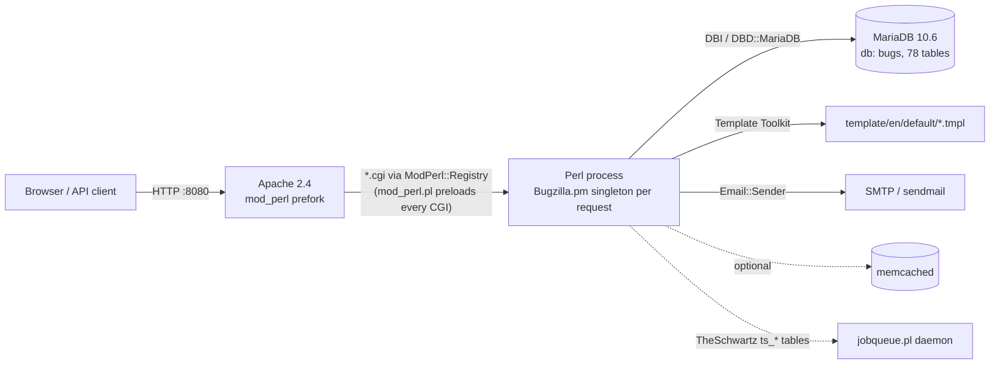
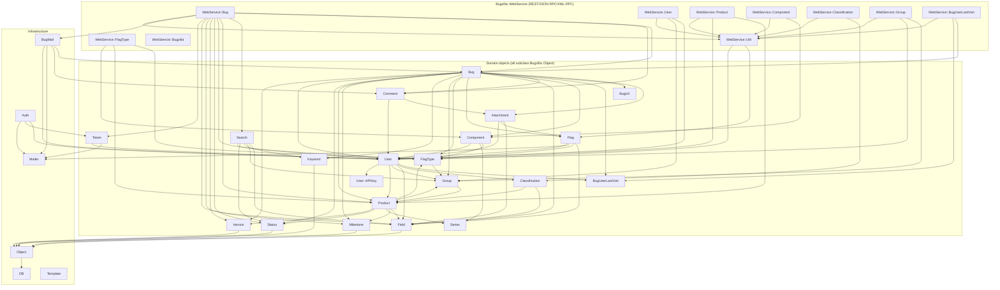
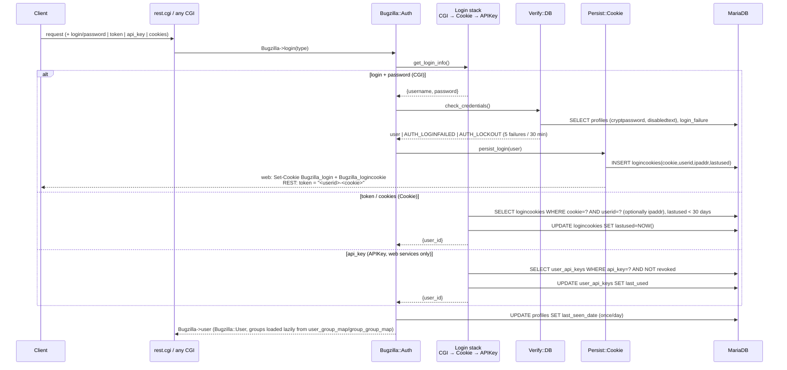

# Bugzilla 5.2 — system map for the Perl → Python migration

Scope: what exists today, as observed in the `5.2` branch running via `docker compose`
(Apache 2.4 + mod_perl 2, Perl 5.34, Template Toolkit, DBI/DBD::MariaDB on MariaDB 10.6).
This document is descriptive; the migration itself is in [PLAN.md](PLAN.md).

Numbers below are from `wc -l` on this checkout: 152 `.pm` files under `Bugzilla/` (~80k LOC),
50 `*.cgi` entry points, 78 tables in `Bugzilla/DB/Schema.pm`.

## 1. Runtime topology

* `mod_perl.pl` registers every `*.cgi` as a `ModPerl::Registry` handler, preloads `Bugzilla::*`,
  and sets `PerlSwitches -w -T` (taint mode). Each Apache child is a long-lived Perl interpreter;
  per-request state lives in `Bugzilla->request_cache` and is reset by `Bugzilla::_cleanup` at the end of the request.
* `.htaccess` rewrites `rest/(.*)` → `rest.cgi/$1`, so both `/rest/…` and `/rest.cgi/…` work.
* Configuration: `localconfig` (DB credentials, generated by `checksetup.pl` from `docker/checksetup_answers.txt`)
  and `data/params.json` (runtime "Parameters" edited via `editparams.cgi`). Params are **not** in the DB.
* Time zone: `Bugzilla->local_timezone` uses `DateTime::TimeZone->new(name => 'local')`, which needs the
  system zoneinfo. The web image lacked `tzdata`, so `buglist.cgi` and REST bug create died with
  "Cannot determine local time zone" (fixed in the Dockerfile by installing `tzdata` and setting `TZ=Etc/UTC`).

## 2. CGI entry points

| Group | Entry points | Main modules used |
|---|---|---|
| **API (machine)** | `rest.cgi`, `jsonrpc.cgi`, `xmlrpc.cgi` | `Bugzilla::WebService::Server::{REST,JSONRPC,XMLRPC}` → `Bugzilla::WebService::*` |
| Bug lifecycle | `enter_bug.cgi`, `post_bug.cgi`, `show_bug.cgi`, `process_bug.cgi`, `show_activity.cgi`, `attachment.cgi`, `showdependencytree.cgi`, `showdependencygraph.cgi`, `summarize_time.cgi` | `Bugzilla::Bug`, `Attachment`, `Flag`, `BugMail`, `Token` |
| Search / reports | `query.cgi`, `buglist.cgi`, `colchange.cgi`, `report.cgi`, `reports.cgi`, `chart.cgi`, `duplicates.cgi`, `search_plugin.cgi`, `page.cgi` | `Bugzilla::Search`, `Search::Quicksearch`, `Search::Saved`, `Report`, `Chart`, `Series` |
| Accounts / auth | `index.cgi`, `createaccount.cgi`, `relogin.cgi`, `token.cgi`, `userprefs.cgi`, `request.cgi` | `Bugzilla::Auth::*`, `User`, `User::APIKey`, `Token`, `Flag` |
| Admin | `admin.cgi`, `editclassifications.cgi`, `editproducts.cgi`, `editcomponents.cgi`, `editversions.cgi`, `editmilestones.cgi`, `editgroups.cgi`, `editusers.cgi`, `editfields.cgi`, `editvalues.cgi`, `editflagtypes.cgi`, `editkeywords.cgi`, `editparams.cgi`, `editsettings.cgi`, `editwhines.cgi`, `editworkflow.cgi`, `sanitycheck.cgi` | the matching `Bugzilla::<Object>` class + `Token` (CSRF) |
| Misc | `config.cgi`, `describecomponents.cgi`, `describekeywords.cgi`, `quips.cgi`, `votes.cgi` (redirect to extension), `testagent.cgi` | |

Every CGI follows the same skeleton: `Bugzilla->login(LOGIN_*)` → read `Bugzilla->cgi` params →
mutate via `Bugzilla::Object` subclasses → `Bugzilla->template->process(...)`. Only the three API
CGIs return JSON/XML; everything else is HTML built from `template/`.

Non-web entry points (unchanged by this migration): `checksetup.pl` (install/upgrade, schema
migration), `jobqueue.pl` (async mail), `whine.pl`/`whineatnews.pl` (scheduled mail), `collectstats.pl`,
`email_in.pl`, `importxml.pl`, `migrate.pl`, `sanitycheck.pl`, `clean-bug-user-last-visit.pl`.

## 3. `Bugzilla/*.pm` modules and dependency graph

### Layers

| Layer | Modules | Notes |
|---|---|---|
| Kernel | `Bugzilla.pm` (service locator: `->dbh`, `->user`, `->login`, `->params`, `->cgi`, `->template`, `->request_cache`, `->memcached`), `Constants`, `Util`, `Error` (`ThrowUserError`/`ThrowCodeError`), `Hook` (extension hooks), `Config` + `Config/*.pm` (params), `Install/*` | Everything depends on these. |
| Data access | `DB.pm` + `DB/{MariaDB,Mysql,Pg,Oracle,Sqlite}.pm`, `DB/Schema.pm` (abstract schema, 78 tables), `Object.pm` (generic ORM: `new`, `check`, `match`, `create`, `update`, `remove_from_db`, `audit_log`) | `Object.pm` is the base class of every domain object; it reads `DB_TABLE`, `DB_COLUMNS`, `VALIDATORS`, `UPDATE_COLUMNS` constants from the subclass and writes `audit_log` on every change. |
| Domain | `Bug` (5.1k LOC), `User` (3.4k), `Search` (3.6k) + `Search/*`, `Product`, `Component`, `Classification`, `Version`, `Milestone`, `Group`, `Flag`, `FlagType`, `Attachment`, `Comment` (+`Comment::TagWeights`), `Field` (+`Field::Choice`, the generic per-field value tables), `Status`, `Keyword`, `BugUrl` (+ `BugUrl/*` see-also providers), `BugUserLastVisit`, `Token`, `User::APIKey`, `User::Setting`, `Series`, `Report`, `Whine/*` | Business rules live here, not in the CGIs or WebService classes. |
| Auth | `Auth.pm`, `Auth/Login/{Stack,CGI,Cookie,APIKey,Env}.pm`, `Auth/Verify/{Stack,DB,LDAP,RADIUS}.pm`, `Auth/Persist/Cookie.pm` | See §5. |
| Presentation | `Template.pm`, `Template/Context.pm`, `Template/Plugin/*`, `CGI.pm` (CGI.pm subclass: cookies, headers, CSP) | HTML only. |
| Messaging | `BugMail`, `Mailer`, `MIME`, `Sender/Transport/Sendmail`, `Job/*`, `JobQueue` (+`Runner`) | Email on bug change; sync or queued via TheSchwartz (`ts_*` tables). |
| API | `WebService.pm` (base), `WebService/Server.pm`, `WebService/Server/{REST,JSONRPC,XMLRPC}.pm`, `WebService/Server/REST/Resources/*.pm`, `WebService/{Bug,User,Product,Component,Classification,Group,FlagType,BugUserLastVisit,Bugzilla}.pm`, `WebService/Util.pm`, `WebService/Constants.pm` | See §4 and §6. |

### Dependency graph (`use Bugzilla::…` statements, kernel modules omitted for readability)

Observations that matter for the port:

* `Bugzilla::Bug` is the hub: it imports 15 other domain modules and is imported by `Search`,
  `BugMail`, `Attachment`, `Comment` and most CGIs. The WebService `Bug` module (4.7k LOC) is a thin
  JSON mapper over it, so "porting Bug" really means porting the parts of `Bug.pm`, `Comment.pm`,
  `Attachment.pm`, `Flag.pm` and `Search.pm` that the REST methods reach.
* `Classification`, `Product`, `Component`, `Version`, `Milestone`, `Group`, `FlagType` form a small
  acyclic cluster with no dependency on `Bug` — the natural first slices.
* `User` depends on `Group`, `Product`, `Classification` (visibility checks) and owns login/lockout
  logic; `Auth` depends on `User`. Any Python slice needs at least the read-side of `User`+`Group`
  for authorization, which is why that goes in the shared core (PLAN §3).
* `Field.pm`/`Field::Choice` is the generic "legal values" machinery: the `priority`, `bug_severity`,
  `op_sys`, `rep_platform`, `resolution`, `bug_status` tables are all `Field::Choice` subclasses
  created at runtime, plus custom `cf_*` fields defined in `fielddefs`.

## 4. REST surface (`rest.cgi`)

Routing: `WebService::Server::REST::_find_resource` loads every `WebService::Server::REST::Resources::*.pm`;
each exports a `rest_resources` list of `(qr{path}, {HTTP_METHOD => {method, params, success_code}})`.
Path captures are mapped to method params by the `params` closure; query-string and JSON body
params are merged (`_retrieve_json_params`), credentials are normalised by `WebService::Util::fix_credentials`
(`login`/`password`/`token`/`api_key` → `Bugzilla_*`), then the JSON-RPC machinery dispatches to
`Bugzilla::WebService::<Class>::<method>`. Every module also lists `PUBLIC_METHODS`, `READ_ONLY`
(allowed on GET) and `LOGIN_EXEMPT`.

| Module (Perl LOC: WS + resources) | REST routes | Methods |
|---|---|---|
| **Bug** (4692 + 179) | `GET/POST /bug`, `GET /bug/` , `GET/PUT /bug/{id_or_alias}`, `GET/POST /bug/{id}/comment`, `GET /bug/comment/{comment_id}`, `GET /bug/comment/tags/{query}`, `PUT /bug/comment/{comment_id}/tags`, `GET /bug/{id}/history`, `GET/POST /bug/{id}/attachment`, `GET/PUT /bug/attachment/{attachment_id}`, `GET /field/bug`, `GET /field/bug/{name_or_id}`, `GET /field/bug/{name_or_id}/values`, `GET /field/bug/{name}/{product}/values` | `search`, `create`, `get`, `update`, `comments`, `add_comment`, `search_comment_tags`, `update_comment_tags`, `history`, `attachments`, `add_attachment`, `update_attachment`, `fields`, `legal_values`; RPC-only: `possible_duplicates`, `render_comment`, `update_see_also`, `update_tags` |
| **User** (1106 + 69) | `GET /login`, `GET /logout`, `GET /valid_login`, `GET/POST /user`, `GET/PUT /user/{id_or_name}` | `login`, `logout`, `valid_login`, `get`, `create`, `update`; RPC-only: `offer_account_by_email` |
| **Product** (964 + 71) | `GET /product_accessible`, `GET /product_enterable`, `GET /product_selectable`, `GET/POST /product`, `GET/PUT /product/{id_or_name}` | `get_accessible_products`, `get_enterable_products`, `get_selectable_products`, `get`, `create`, `update` |
| **Component** (152 + 44) | `POST /component` | `create` (update/delete do not exist in 5.2) |
| **Classification** (224 + 51) | `GET /classification/{id_or_name}` | `get` |
| **Group** (613 + 57) | `GET/POST /group`, `PUT /group/{id_or_name}` | `get`, `create`, `update` |
| **FlagType** (846 + 69) | `POST /flag_type`, `GET /flag_type/{product}[/{component}]`, `PUT /flag_type/{id_or_name}` | `get`, `create`, `update` |
| **BugUserLastVisit** (206 + 53) | `GET/POST /bug_user_last_visit/{bug_id}` (POST also accepts `ids`) | `get`, `update` |
| **Bugzilla** (530 + 46) | `GET /version`, `/extensions`, `/timezone`, `/time`, `/last_audit_time`, `/parameters` | one method each |

Cross-cutting contract (all modules):

* Response is always a JSON object. Scalars are wrapped as `{"result": …}`. Errors are
  `{"error": true, "code": <int>, "message": "…", "documentation": "<url>"}` with HTTP status from
  `REST_STATUS_CODE_MAP` (51/101 → 404, 102/106/109/… → 401, everything else → 400; unknown fatal → 500).
  Error codes come from `WS_ERROR_CODE` in `WebService/Constants.pm` (e.g. `param_required`=50,
  `object_does_not_exist`=51, `bug_id_does_not_exist`=101, `bug_access_denied`=102,
  `illegal_field`=104, `product_unknown_component`=105; "Cannot determine local time zone" surfaced as 100500 = unknown fatal).
* `include_fields` / `exclude_fields` (comma lists, `_default`, `_all`, `_custom` groups) are
  applied by `WebService::Util::filter`.
* Typed scalars: booleans are JSON `true/false`, ints are numbers, `dateTime` values are serialised
  as `YYYY-MM-DDTHH:MM:SSZ` (UTC); input dates accept the same shape.
* `POST` with `success_code => STATUS_CREATED` returns 201; `PUT` returns 200 with `{"bugs":[{changes…}]}`-style
  change sets.
* `ETag` header from `bz_etag` (md5 of the response), `Access-Control-Allow-Origin: *`.
* JSONP via `callback=`; content negotiation across `application/json`, `application/javascript`, `text/html`.
* Documentation for each method is POD in the WS module and RST in `docs/en/rst/api/core/v1/`.

The same `WebService::*` classes are also exposed over JSON-RPC (`jsonrpc.cgi`, method name
`Bug.get`) and XML-RPC (`xmlrpc.cgi`). Those transports stay on Perl.

## 5. Auth and session flow

Three credential types, resolved by `Bugzilla::Auth` through a *login stack* (`Auth::Login::Stack`)
built from the `user_info_class` param (`CGI` here) + `Cookie` + `APIKey`, and a *verify stack*
(`user_verify_class`, `DB` here; `LDAP`/`RADIUS` optional):

Details worth preserving in Python:

* **Login rule for REST** (`WebService::Server::handle_login` + `REST::handle_login`): if the
  method is `LOGIN_EXEMPT` (`User.login`, `User.offer_account_by_email`) and no `Bugzilla_login`
  is present, skip auth; otherwise call `Bugzilla->login()` which authenticates if credentials are
  present and otherwise leaves the request anonymous (`LOGIN_OPTIONAL`). Methods that need a user
  call `Bugzilla->login(LOGIN_REQUIRED)` themselves (e.g. `Bug.create`), producing error 410 (`login_required`) → HTTP 401.
  `login`/`password` in the query string are only honoured on `GET /login`; for other methods they
  must be in the JSON body or you must use `token`/`api_key` (cross-domain protection).
* **Token format**: `GET /login` returns `{"id": <userid>, "token": "<userid>-<logincookie>"}`.
  `Auth::Login::Cookie::login_token` splits it and validates against `logincookies` exactly like
  the browser cookie pair; `GET /logout` deletes the row. Max age 30 days (`MAX_LOGINCOOKIE_AGE`).
* **Password hashing**: `Bugzilla::Util::bz_crypt` — `cryptpassword` is `"<salt>,<base64(sha256(password+salt))>{SHA-256}"`
  (legacy `crypt()` hashes have no `{…}` suffix and are upgraded on next login). Lockout: `login_failure`
  table, `MAX_LOGIN_ATTEMPTS`=5 within `LOGIN_LOCKOUT_INTERVAL`=30 min per IP.
* **API keys**: `user_api_keys(api_key, user_id, description, revoked, last_used)`; `Bugzilla_api_key`
  param or `X-BUGZILLA-API-KEY` header (header mapping is done in `Bugzilla::CGI`).
* **Authorization**: group membership (`user_group_map`, inherited via `group_group_map`) drives
  everything: `editcomponents`/`editusers`/`creategroups`/`editclassifications` for the admin APIs,
  `bug_group_map` + `group_control_map` for bug visibility (`User::can_see_bug`, `User::can_enter_product`),
  `insidergroup` for private comments/attachments. `profiles.disabledtext` blocks login. `bz_sudoers` allows impersonation via the `sudo` cookie (web only).
* **CSRF tokens** (`tokens` table, `issue_session_token`/`check_token_data`) protect HTML forms only;
  REST has none and relies on the token/api_key rule above. Other `tokens` rows: `password`, `emailnew`/`emailold`,
  `account`, `api_token`.
* **Sessions are server-side rows, not signed cookies.** A Python service can honour the same
  `token`/`api_key`/cookie pair by querying `logincookies` / `user_api_keys` — no shared secret
  is required, which is what makes a split Perl/Python deployment possible.

## 6. Database tables touched per WebService module

Derived from `DB_TABLE` constants and SQL in the domain modules each WebService class reaches
(direct and one level down). **R** = read, **W** = insert/update/delete.

| Module | Tables |
|---|---|
| **Bugzilla** | R `audit_log` (`last_audit_time`); `version`/`extensions`/`timezone`/`time` read nothing; `parameters` reads `data/params.json` (file, not DB) filtered by `PUBLIC_PARAMS`/admin |
| **Classification** | R `classifications`, `products` (visible products per classification via `User::get_selectable_products` → `group_control_map`, `user_group_map`) |
| **Product** | R/W `products`, `versions`, `milestones`, `components`, `classifications`; R `group_control_map`, `groups`, `user_group_map`, `group_group_map`, `bug_group_map` (visibility); W `series`, `series_categories` (when `create_series`), `audit_log` |
| **Component** | W `components`, `component_cc`, `audit_log`; R `products`, `profiles` (default assignee / QA / CC lookups), `flagtypes` via `Product` |
| **Group** | R/W `groups`, `group_group_map`, `user_group_map`, `audit_log`; R `profiles` (membership listing), `group_control_map`, `products`, `bug_group_map` (`get` with `membership`/`bugs` info) |
| **User** | R/W `profiles`, `logincookies`, `login_failure`, `user_group_map`, `audit_log`, `profiles_activity`; R `groups`, `group_group_map`, `user_api_keys`, `tokens` (`api_token`), `email_setting`, `setting`/`profile_setting` (for `get` of own account), `products`/`group_control_map` (`can_see_user` / visibility rules), `mail_staging` (account-creation mail) |
| **FlagType** | R/W `flagtypes`, `flaginclusions`, `flagexclusions`, `audit_log`; R `products`, `components`, `groups` (grant/request groups), `flags` (counts) |
| **BugUserLastVisit** | R/W `bug_user_last_visit`; R `bugs`, `bug_group_map`, `group_control_map`, `cc` (via `Bug->check` visibility) |
| **Bug** | R/W `bugs`, `bugs_activity`, `bugs_aliases`, `longdescs`, `longdescs_tags`, `longdescs_tags_weights`, `longdescs_tags_activity`, `cc`, `dependencies`, `duplicates`, `keywords`, `bug_see_also`, `bug_group_map`, `attachments`, `attach_data`, `flags`, `bugs_fulltext`, `bug_user_last_visit`, `tag`/`bug_tag`, `audit_log`; R `fielddefs`, `field_visibility`, `bug_status`, `status_workflow`, `resolution`, `bug_severity`, `priority`, `rep_platform`, `op_sys`, custom `cf_*` value tables, `products`, `components`, `versions`, `milestones`, `classifications`, `keyworddefs`, `flagtypes`, `flaginclusions`/`flagexclusions`, `profiles`, `groups`, `group_control_map`, `user_group_map`, `email_setting`, `watch`, `email_bug_ignore`; W (side effect) `mail_staging`/`ts_*` when mail is queued |

Shared by every authenticated call: R/W `logincookies` or `user_api_keys` (`lastused`), R/W `profiles.last_seen_date`.

## 7. Write paths and side effects to keep in mind

* Every `Object->create/update/remove_from_db` writes `audit_log` (class, object_id, field, removed, added, at_time).
* `Bug->update` writes `bugs_activity` for each changed field, bumps `bugs.delta_ts` and `lastdiffed`, and
  `send_changes` sends mail (`BugMail::Send`) synchronously unless `use_mailer_queue` is on.
* `bugs_fulltext` (`short_desc`, `comments`, `comments_noprivate`) is maintained by `Bug::_sync_fulltext` on
  create/update — the MariaDB FULLTEXT index that `Search` uses for "content" matches.
* `Bug.create`/`Bug.update` commit the transaction **before** `send_changes` runs. A mailer failure
  (e.g. `mail_delivery_method=Sendmail` with no sendmail binary in the image) therefore returns an
  error envelope (code 100500) with HTTP 200 while the bug has already been written. The Docker
  setup now sets `mail_delivery_method=None` in `docker/checksetup_answers.txt`.
* Mid-air collision check: `process_bug.cgi` compares `delta_ts`; the REST `Bug.update` does **not**
  (last writer wins).
* `Bug.search` is backed by `Bugzilla::Search`, a 3.6k LOC query builder (boolean charts, custom
  fields, quicksearch). Its exact SQL semantics are the single largest parity risk in the Bug slice.
