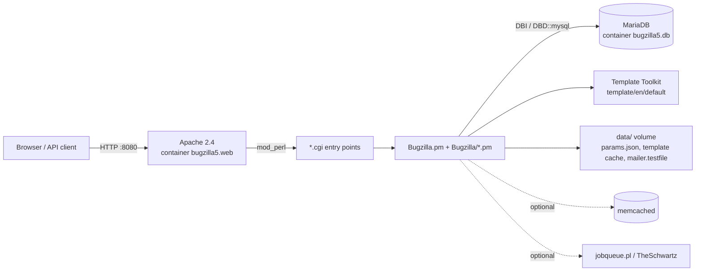
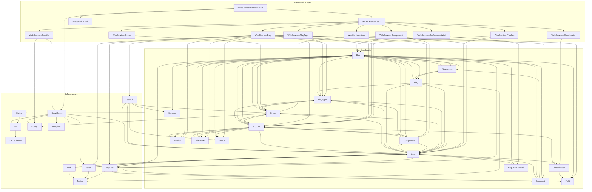
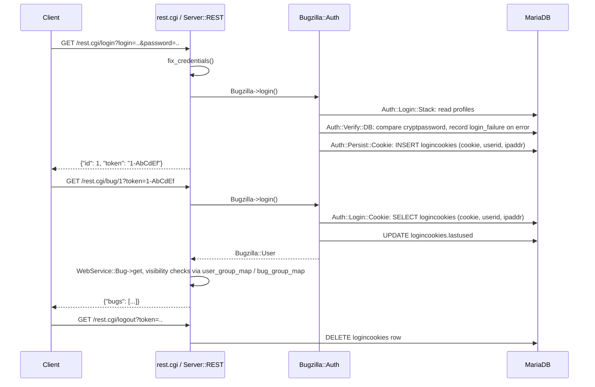

# Bugzilla 5.2 (Perl) architecture map

Scope: the Perl application on branch `5.2`, as the baseline for the incremental Python migration
described in [PLAN.md](PLAN.md).

How this map was produced:

- **Static**: read from the source (`*.cgi`, `Bugzilla/**/*.pm`, `mod_perl.pl`, `Bugzilla/DB/Schema.pm`).
- **Observed**: taken from the running docker stack (`docker compose up -d --build`) seeded with
  `scripts/seed_demo_data.py`. The table lists in section 4 come from the MariaDB general query log,
  captured one REST call at a time as the admin user.

Anything observed is labelled as such. Observed table lists only cover the code path of the one
request that was sent; other parameters, non-admin users or enabled extensions can touch more tables.

## 1. Runtime topology

- The docker image runs under mod_perl: `docker/000-default.conf` loads `mod_perl.pl`, which
  preloads the code and routes every `*.cgi` through `Bugzilla::ModPerl::ResponseHandler`. The same
  scripts also run as plain CGI.
- All state is in MariaDB plus the `data/` directory. Perl processes hold only per-request state
  (`Bugzilla->request_cache`).
- Extensions shipped in `extensions/`: BmpConvert, Example, MoreBugUrl, OldBugMove, Voting. They hook
  into core through `Bugzilla::Hook::process`.

## 2. CGI entry points

50 scripts in the repository root.

| Area | Scripts |
|---|---|
| API | `rest.cgi`, `jsonrpc.cgi`, `xmlrpc.cgi` |
| Bug view and edit | `show_bug.cgi`, `enter_bug.cgi`, `post_bug.cgi`, `process_bug.cgi`, `attachment.cgi`, `show_activity.cgi`, `showdependencygraph.cgi`, `showdependencytree.cgi`, `summarize_time.cgi`, `votes.cgi` |
| Search and lists | `query.cgi`, `buglist.cgi`, `colchange.cgi`, `duplicates.cgi`, `request.cgi`, `search_plugin.cgi` |
| Reports | `report.cgi`, `reports.cgi`, `chart.cgi` |
| Browse | `index.cgi`, `describecomponents.cgi`, `describekeywords.cgi`, `page.cgi`, `quips.cgi`, `config.cgi` |
| Account and session | `createaccount.cgi`, `token.cgi`, `relogin.cgi`, `userprefs.cgi` |
| Administration | `admin.cgi`, `editclassifications.cgi`, `editcomponents.cgi`, `editfields.cgi`, `editflagtypes.cgi`, `editgroups.cgi`, `editkeywords.cgi`, `editmilestones.cgi`, `editparams.cgi`, `editproducts.cgi`, `editsettings.cgi`, `editusers.cgi`, `editvalues.cgi`, `editversions.cgi`, `editwhines.cgi`, `editworkflow.cgi`, `sanitycheck.cgi` |
| Diagnostics | `testagent.cgi` |

Only `rest.cgi` is in scope for the migration plan. `jsonrpc.cgi` and `xmlrpc.cgi` expose the same
`Bugzilla::WebService::*` methods over other transports and stay on Perl.

## 3. Core modules and dependency graph

### 3.1 Module groups

| Group | Modules | Role |
|---|---|---|
| Request context | `Bugzilla.pm`, `Bugzilla::CGI`, `Bugzilla::Config`, `Bugzilla::Constants`, `Bugzilla::Error`, `Bugzilla::Util`, `Bugzilla::Hook`, `Bugzilla::Extension` | Per-request singleton: `Bugzilla->user`, `->dbh`, `->params`, `->cgi`, `->template`. |
| Persistence | `Bugzilla::DB` (+ `DB::Mysql`, `DB::Pg`, `DB::Oracle`, `DB::Sqlite`), `Bugzilla::DB::Schema`, `Bugzilla::Object`, `Bugzilla::Memcached` | DBI wrapper, abstract schema (76 tables), and the base class for every domain object (`new`, `match`, `create`, `update`, validators, audit log). |
| Auth | `Bugzilla::Auth`, `Auth::Login::{Stack,CGI,Cookie,APIKey,Env}`, `Auth::Verify::{Stack,DB,LDAP,RADIUS}`, `Auth::Persist::Cookie`, `Bugzilla::Token` | Login stack, credential verification, session cookies and tokens. |
| Domain objects | `Bug`, `Comment`, `Attachment`, `Flag`, `FlagType`, `User`, `Group`, `Product`, `Component`, `Classification`, `Version`, `Milestone`, `Keyword`, `Status`, `Field`, `Field::Choice`, `BugUrl`, `BugUserLastVisit` | Business rules. Largest: `Bug.pm` 5123 lines, `User.pm` 3407, `Product.pm` 1185. |
| Search | `Bugzilla::Search` (3561 lines), `Search::Quicksearch`, `Search::Saved`, `Search::Recent`, `Search::Clause*` | Translates search parameters into one SQL statement with group-visibility joins. |
| Mail | `Bugzilla::BugMail`, `Bugzilla::Mailer`, `Bugzilla::MIME`, `Bugzilla::JobQueue` | Bug change notifications, sent inline or queued. |
| Presentation | `Bugzilla::Template` and `template/` | Template Toolkit for HTML and mail. |
| Web services | `Bugzilla::WebService`, `WebService::Server::{REST,JSONRPC,XMLRPC}`, `WebService::Server::REST::Resources::*`, `WebService::{Bug,Product,Component,Classification,Group,User,FlagType,BugUserLastVisit,Bugzilla}`, `WebService::{Util,Constants}` | API layer over the domain objects. |

### 3.2 Dependency graph

Edges are `use`/`require` statements in the source. `Constants`, `Util`, `Error` and `Hook` are used
almost everywhere and are omitted. The domain layer has many cycles (for example Bug, Product,
Component and User all load each other).

## 4. Database tables per WebService module

Schema source: `Bugzilla/DB/Schema.pm` (76 tables).

**Observed** with the MariaDB general log, one request at a time, authenticated as the admin user
with a login token. R = read only, W = written.

Common to every authenticated request (not repeated below):

- R `profiles`, `groups`, `user_group_map`, `group_group_map` (user and group membership).
- W `logincookies` (`lastused` is updated when a token is validated).
- The trace also showed a statement against `tokens` on `GET /login` and `POST /user`; the code path
  was not identified (token validation itself reads only `logincookies`).
- Bug-level access checks add R `bugs`, `bug_group_map`, `cc`.
- Every write endpoint also issued a statement against `mail_staging`.

### 4.1 Bug

| Request | Written | Read (besides the common set) |
|---|---|---|
| `GET /bug/{id}` | none | `bugs`, `bugs_aliases`, `bug_see_also`, `bug_status`, `cc`, `classifications`, `components`, `dependencies`, `fielddefs`, `flags`, `flagtypes`, `flaginclusions`, `flagexclusions`, `keywords`, `longdescs`, `products` |
| `GET /bug?product=&status=` | none | same as `GET /bug/{id}` (105 statements for 12 results) |
| `POST /bug` | `bugs`, `bugs_fulltext`, `cc`, `longdescs` | `bug_severity`, `bug_status`, `priority`, `op_sys`, `rep_platform`, `status_workflow`, `products`, `components`, `component_cc`, `versions`, `milestones`, `classifications`, `group_control_map`, `dependencies`, `fielddefs`, `flags`, `flagtypes`, `flaginclusions`, `flagexclusions`, `keywords`, `longdescs_tags`, `bugs_activity`, `watch`, `email_setting`, `email_bug_ignore`, `setting`, `profile_setting` |
| `PUT /bug/{id}` (status, cc, depends_on) | `bugs`, `bugs_activity`, `cc`, `dependencies`, `bug_user_last_visit` | `bugs_aliases`, `bug_see_also`, `bug_status`, `status_workflow`, `products`, `components`, `classifications`, `group_control_map`, `fielddefs`, `flags`, `flagtypes`, `flaginclusions`, `flagexclusions`, `keywords`, `longdescs`, `longdescs_tags`, `watch`, `email_setting`, `email_bug_ignore`, `setting`, `profile_setting` |
| `GET /bug/{id}/comment` | none | `longdescs`, `longdescs_tags`, `fielddefs` |
| `POST /bug/{id}/comment` | `longdescs`, `bugs`, `bugs_fulltext` | `bugs_activity`, `bugs_aliases`, `bug_see_also`, `bug_status`, `bug_user_last_visit`, `dependencies`, `fielddefs`, `flags`, `flagtypes`, `flaginclusions`, `flagexclusions`, `group_control_map`, `keywords`, `longdescs_tags`, `setting`, `profile_setting` |
| `PUT /bug/comment/{id}/tags` | `longdescs_tags`, `longdescs_tags_activity`, `longdescs_tags_weights` | `longdescs`, `fielddefs` |
| `GET /bug/{id}/history` | none | `bugs_activity`, `bugs_aliases`, `fielddefs` |
| `GET /bug/{id}/attachment` | none | `attachments`, `attach_data`, `flagtypes`, `flaginclusions`, `flagexclusions`, `fielddefs` |
| `POST /bug/{id}/attachment` | `attachments`, `attach_data`, `longdescs`, `bugs`, `bugs_fulltext`, `bug_user_last_visit` | as `POST /bug/{id}/comment`, plus `products`, `components`, `classifications`, `watch`, `email_setting`, `email_bug_ignore` |
| `GET /field/bug` | none | `fielddefs`, `bug_severity`, `bug_status`, `priority`, `op_sys`, `rep_platform`, `resolution`, `status_workflow`, `keyworddefs`, `classifications`, `products`, `components`, `versions`, `milestones`, `group_control_map` |
| `GET /field/bug/priority/values` | none | `fielddefs`, `priority` |

Not exercised (static reading of `Bugzilla/Bug.pm` and `Bugzilla/Search.pm`): updates that change
keywords, see-also URLs, aliases, groups, duplicates or flags also write `keywords`, `bug_see_also`,
`bugs_aliases`, `bug_group_map`, `duplicates`, `flags`. Searches on other fields join the matching
tables.

### 4.2 Other modules

| Module | Request | Written | Read (besides the common set) |
|---|---|---|---|
| Product | `GET /product/{name}` | none | `products`, `components`, `versions`, `milestones`, `classifications`, `group_control_map`, `flagtypes`, `flaginclusions`, `flagexclusions` |
| Product | `GET /product_accessible` | none | `products`, `components`, `versions`, `group_control_map` |
| Product | `POST /product` | `products`, `versions`, `milestones`, `series`, `series_categories`, `audit_log` | `components`, `group_control_map`, `bug_status`, `resolution` |
| Product | `PUT /product/{name}` | `products`, `audit_log` | `components`, `versions`, `group_control_map` |
| Component | `POST /component` | `components`, `audit_log` | `products`, `versions`, `group_control_map` |
| Classification | `GET /classification/{id}` | none | `classifications`, `products` |
| Group | `GET /group` | none | common set only |
| Group | `POST /group` | `groups`, `group_group_map`, `audit_log` | common set only |
| Group | `PUT /group/{name}` | `groups`, `audit_log` | common set only |
| User | `GET /login` | `logincookies`, `profiles`, `login_failure` | `tokens` |
| User | `GET /logout` | `logincookies` | common set only |
| User | `GET /valid_login` | none | common set only |
| User | `GET /user?names=` | none | common set only |
| User | `POST /user` | `profiles`, `profiles_activity`, `email_setting`, `user_group_map`, `audit_log` | `fielddefs`, `tokens` |
| User | `PUT /user/{name}` (name, groups) | `profiles`, `profiles_activity`, `user_group_map`, `audit_log` | `fielddefs` |
| FlagType | `GET /flag_type/{product}` | none | `flagtypes`, `flaginclusions`, `flagexclusions`, `products`, `components`, `versions`, `group_control_map` |
| FlagType | `POST /flag_type` | `flagtypes`, `flaginclusions`, `flagexclusions`, `audit_log` | `flags`, `bugs`, `products`, `components`, `versions`, `group_control_map` |
| FlagType | `PUT /flag_type/{id}` | `flagtypes`, `audit_log` | `flags`, `bugs`, `flaginclusions`, `flagexclusions` |
| BugUserLastVisit | `POST /bug_user_last_visit/{id}` | `bug_user_last_visit` | `bugs`, `bug_group_map`, `cc`, `fielddefs` |
| BugUserLastVisit | `GET /bug_user_last_visit/{id}` | none | `bug_user_last_visit`, `bugs`, `bug_group_map`, `cc` |
| Bugzilla | `GET /version`, `GET /timezone` | none | none (0 statements) |
| Bugzilla | `GET /time`, `GET /extensions`, `GET /parameters` | none | common set only (`params.json` is a file) |
| Bugzilla | `GET /last_audit_time` | none | `audit_log` |

Observed defect in the Perl baseline: `GET /bug_user_last_visit/{id}` returned HTTP 200 with an error
envelope, code 100500, `Can't locate object method "id" via package "1"`. `POST` on the same path
works.

## 5. Authentication and session flow

### 5.1 Credentials accepted by `rest.cgi`

`Bugzilla::WebService::Util::fix_credentials` renames REST parameters before authentication:

| REST parameter | Internal parameter | Checked against |
|---|---|---|
| `login` + `password` | `Bugzilla_login`, `Bugzilla_password` | `profiles.cryptpassword` (`Auth::Verify::DB`; salted SHA-256, 8-character salt) |
| `api_key` | `Bugzilla_api_key` | `user_api_keys` (`Auth::Login::APIKey`) |
| `token` | `Bugzilla_token` (format `<user_id>-<login_token>`) | `logincookies` (`Auth::Login::Cookie`): cookie, user id, and IP address unless the row's `ipaddr` is NULL |
| Cookies `Bugzilla_login`, `Bugzilla_logincookie` | n/a | `logincookies`, same check |

Static reading, not exercised here:

- Cookie login is honoured only on `POST` and `PUT` (and `GET /login`). On other `GET` requests
  `Server::REST::handle_login` disables automatic login, so cookies are ignored.
- If a `Bugzilla_api_token` parameter is supplied with cookies it must be a valid `api_token` for
  the same user (`tokens` table); if it is absent it is not checked.
- Cookies take precedence over `token` when both are sent.
- The login token is the `logincookies.cookie` value; `Auth::Persist::Cookie` inserts the row with
  the client IP unless `Bugzilla_restrictlogin` is off.

### 5.2 Sequence

Relevant limits in `Bugzilla/Constants.pm`: login cookies expire after 30 days unused
(`MAX_LOGINCOOKIE_AGE`), tokens after 3 days (`MAX_TOKEN_AGE`), and an account is locked for 30
minutes after 5 failed logins (`MAX_LOGIN_ATTEMPTS`, `LOGIN_LOCKOUT_INTERVAL`).

`Bugzilla->login` also handles `sudo` impersonation (cookie `sudo`, groups `bz_sudoers` and
`bz_sudo_protect`) and the `requirelogin` parameter.

### 5.3 Authorisation

- Bug visibility: `bug_group_map` against the user's groups (`user_group_map` expanded through
  `group_group_map`), with exceptions for reporter, assignee, QA contact and CC members.
- Product access: `group_control_map` (entry, canedit, editcomponents, editbugs, canconfirm).
- Admin endpoints check named groups: `editcomponents`, `creategroups`, `editusers`, `admin`.

## 6. REST surface

Dispatch: `rest.cgi` -> `Bugzilla::WebService::Server::REST`, which loads every
`Server/REST/Resources/*.pm`, matches the path against each regex and calls the mapped method on the
`Bugzilla::WebService::*` module. Path captures, the JSON body and query parameters are merged into
one parameter hash.

| Module | Method and path | WebService method | Success |
|---|---|---|---|
| Bug | `GET /bug` | `search` | 200 |
| Bug | `POST /bug` | `create` | 200 |
| Bug | `GET /bug/{id}` | `get` | 200 |
| Bug | `GET /bug/` (ids in query) | `get` | 200 |
| Bug | `PUT /bug/{id}` | `update` | 200 |
| Bug | `GET /bug/{id}/comment` | `comments` | 200 |
| Bug | `POST /bug/{id}/comment` | `add_comment` | 201 |
| Bug | `GET /bug/comment/{comment_id}` | `comments` | 200 |
| Bug | `GET /bug/comment/tags/{query}` | `search_comment_tags` | 200 |
| Bug | `PUT /bug/comment/{comment_id}/tags` | `update_comment_tags` | 200 |
| Bug | `GET /bug/{id}/history` | `history` | 200 |
| Bug | `GET /bug/{id}/attachment` | `attachments` | 200 |
| Bug | `POST /bug/{id}/attachment` | `add_attachment` | 201 |
| Bug | `GET /bug/attachment/{attachment_id}` | `attachments` | 200 |
| Bug | `PUT /bug/attachment/{attachment_id}` | `update_attachment` | 200 |
| Bug | `GET /field/bug` | `fields` | 200 |
| Bug | `GET /field/bug/{field}` | `fields` | 200 |
| Bug | `GET /field/bug/{field}/values` | `legal_values` | 200 |
| Bug | `GET /field/bug/{field}/{product_id}/values` | `legal_values` | 200 |
| BugUserLastVisit | `GET /bug_user_last_visit/{id}` | `get` | 200 |
| BugUserLastVisit | `POST /bug_user_last_visit/{id}` | `update` | 200 |
| Bugzilla | `GET /version` | `version` | 200 |
| Bugzilla | `GET /extensions` | `extensions` | 200 |
| Bugzilla | `GET /timezone` | `timezone` | 200 |
| Bugzilla | `GET /time` | `time` | 200 |
| Bugzilla | `GET /last_audit_time` | `last_audit_time` | 200 |
| Bugzilla | `GET /parameters` | `parameters` | 200 |
| Classification | `GET /classification/{id_or_name}` | `get` | 200 |
| Component | `POST /component` | `create` | 201 |
| FlagType | `POST /flag_type` | `create` | 201 |
| FlagType | `GET /flag_type/{product}` | `get` | 200 |
| FlagType | `GET /flag_type/{product}/{component}` | `get` | 200 |
| FlagType | `PUT /flag_type/{id_or_name}` | `update` | 200 |
| Group | `GET /group` | `get` | 200 |
| Group | `POST /group` | `create` | 201 |
| Group | `PUT /group/{id_or_name}` | `update` | 200 |
| Product | `GET /product_accessible` | `get_accessible_products` | 200 |
| Product | `GET /product_enterable` | `get_enterable_products` | 200 |
| Product | `GET /product_selectable` | `get_selectable_products` | 200 |
| Product | `GET /product` | `get` | 200 |
| Product | `POST /product` | `create` | 201 |
| Product | `GET /product/{id_or_name}` | `get` | 200 |
| Product | `PUT /product/{id_or_name}` | `update` | 200 |
| User | `GET /login` | `login` | 200 |
| User | `GET /logout` | `logout` | 200 |
| User | `GET /valid_login` | `valid_login` | 200 |
| User | `GET /user` | `get` | 200 |
| User | `POST /user` | `create` | 201 |
| User | `GET /user/{id_or_name}` | `get` | 200 |
| User | `PUT /user/{id_or_name}` | `update` | 200 |

The "Success" column is the `success_code` declared in the resource files; verify each one in the
contract tests rather than trusting this table. Methods that exist only on JSON-RPC/XML-RPC
(`Bug.possible_duplicates`, `Bug.render_comment`, `Bug.update_see_also`, `Bug.update_tags`,
`User.offer_account_by_email`) have no REST route.

### 6.1 Response and error contract

- Success: JSON object; shape is specific to each method.
- Error: `{"error": true, "code": <int>, "message": "...", "documentation": "..."}`.
- HTTP status comes from `REST_STATUS_CODE_MAP` in `Bugzilla/WebService/Constants.pm`: codes 51, 101
  and 32614 map to 404; the authorisation codes (102, 106, 109, 110, 113, 115, 120, 300-304, 410,
  504, 505) map to 401; everything else maps to 400.
- Observed: `/version` returns `{"version":"5.2+"}`; `POST /bug` without credentials returns 401; a
  missing bug returns 404 with code 101; an unknown path returns 404 with code 32614.

### 6.2 Behaviours a reimplementation must copy

Observed unless marked otherwise:

- Internal Perl errors (code 100500) are returned with HTTP 200 and an error envelope.
- For non-GET requests, query parameters override JSON body values (static:
  `Server/REST.pm`).
- `POST /bug` needs explicit `priority` and `severity` in this configuration.
- `POST /bug` commits the bug before sending mail, so a mail failure returns an error for a bug that
  exists.
- Bug changes send mail through `Bugzilla::BugMail`; in docker, on a fresh data volume, this is
  written to `data/mailer.testfile` (an existing `data/params.json` keeps its own
  `mail_delivery_method`).
- Static: responses carry an `ETag`, and a matching `If-None-Match` returns `304 Not Modified` with
  no body (`Server::JSONRPC::response`, inherited by REST).
- Token validation writes to `logincookies`, so even "read" requests write to the database.
