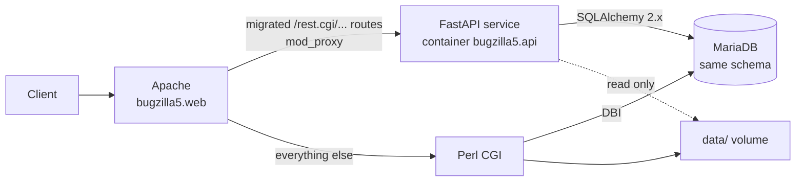
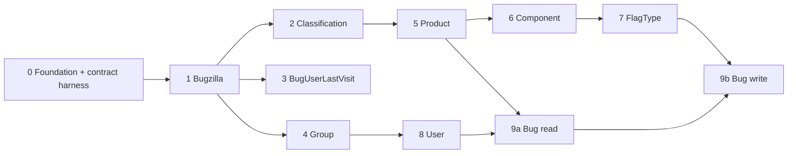

# Perl to Python migration plan

Companion to [ARCHITECTURE.md](ARCHITECTURE.md). Status: proposal for review. No Python has been
written.

## 1. Principles

1. **Strangler pattern.** One REST slice moves at a time. Perl keeps every route that has not moved.
2. **Perl is the source of truth.** A slice is switched over only after its contract tests pass
   against both implementations. Switching back is a proxy change.
3. **Same database, no data migration.** Python reads and writes the existing MariaDB schema. Perl
   (`checksetup.pl`) remains the only owner of schema changes.
4. **Black-box parity.** The contract is the HTTP behaviour of `rest.cgi`, including its quirks, not
   the Perl internals.
5. **REST only.** HTML CGI pages, `jsonrpc.cgi` and `xmlrpc.cgi` are out of scope.

## 2. Target architecture



| Concern | Choice |
|---|---|
| Framework | FastAPI, served by uvicorn, in its own container (`bugzilla5.api`). |
| Persistence | SQLAlchemy 2.x, typed `Mapped[]` models written by hand against the existing tables. No Alembic, no `create_all`. |
| Schemas | Pydantic v2 models for requests and responses. OpenAPI generated by FastAPI at `/openapi.json`. |
| State | None in the process. Sessions stay in `logincookies`, `tokens` and `user_api_keys`, so a token issued by Perl works on Python and the reverse. |
| Configuration | DB credentials from environment. Bugzilla parameters read from `data/params.json` (mounted read-only). `site_wide_secret` from `localconfig`, needed to sign the bug `update_token` so that Perl's `process_bug.cgi` accepts it. |
| Routing | Apache `ProxyPass` rules, one per migrated path prefix, in front of the CGI handler. Rollback is removing the rule. |
| Errors | One exception type carrying the Bugzilla error code; a single handler renders the Perl error envelope and maps the code to the HTTP status with the same table as `REST_STATUS_CODE_MAP`. |
| Transactions | Commit at the same points as Perl (`bz_start_transaction` / `bz_commit_transaction`), not one transaction per request. Example: bug create and update commit before mail is sent, so a mail failure returns an error for a change that is saved. |

Proposed layout:

```
api/
  Dockerfile
  pyproject.toml
  bugzilla_api/
    main.py            app factory, router registration
    db.py              engine, session dependency
    models/            SQLAlchemy models, one file per table group
    auth.py            login / token / api_key resolution, group expansion
    errors.py          error codes and envelope
    params.py          params.json reader
    routers/           one router per WebService module
    schemas/           Pydantic models per module
tests/contract/        black-box tests, see section 5
```

### 2.1 Shared foundation (built once, before the first slice)

| Piece | Mirrors | Notes |
|---|---|---|
| Auth dependency | `Bugzilla::Auth`, `WebService::Util::fix_credentials`, `Server::REST::handle_login` | `login`+`password`, `token`, `api_key`, and the browser cookies (`Bugzilla_login`, `Bugzilla_logincookie`, optional `Bugzilla_api_token`) on `POST`/`PUT`. Password check must match the `profiles.cryptpassword` format. Token validation applies the same IP check and updates `logincookies.lastused` as Perl does. Apache must pass the client IP to Python. |
| Group resolution | `Bugzilla::User::groups` | `user_group_map` expanded through `group_group_map`. Needed by every visibility check. |
| Parameter merging | `Server::REST` | Path, body and query merged; query overrides body on non-GET. |
| Field filtering | `WebService::Util::filter` | `include_fields` / `exclude_fields`, applied only where the Perl method applies it (for example `version` always returns its key). |
| Error envelope | `Bugzilla::Error`, `WebService::Constants` | Copy `WS_ERROR_CODE` and the status map as data. |
| Audit log | `Bugzilla::Object::audit_log` | Admin writes insert into `audit_log`. |

## 3. Migration units

Sizes are source lines of the `Bugzilla/WebService/<Module>.pm` file including its POD. The real
effort is driven by the domain modules behind it, listed under "Depends on".

| # | Unit | REST routes | WS lines | Size | Risk | Depends on (Perl modules to reproduce) | Python prerequisites |
|---|---|---|---|---|---|---|---|
| 0 | Foundation | none | n/a | M | Medium | `Auth`, `Token`, `Error`, `Server::REST`, `WebService::Util` | none |
| 1 | Bugzilla | 6 GET | 530 | S | Low | `Config` (`params.json`), `Extension`, `audit_log` | 0 |
| 2 | Classification | 1 GET | 224 | S | Low | `Classification`, `Product` (read) | 0 |
| 3 | BugUserLastVisit | 1 GET, 1 POST | 206 | S | Low | `BugUserLastVisit`, bug visibility check | 0 |
| 4 | Group | 1 GET, 1 POST, 1 PUT | 613 | M | Medium | `Group`, membership and `group_group_map` maintenance, `audit_log` | 0 |
| 5 | Product | 5 GET, 1 POST, 1 PUT | 964 | M | Medium | `Product`, `Component`, `Version`, `Milestone`, `group_control_map`, `Series` on create | 0, 2 |
| 6 | Component | 1 POST | 152 | S | Low | `Component`, `Product`, default assignee / CC | 5 |
| 7 | FlagType | 2 GET, 1 POST, 1 PUT | 846 | M | Medium | `FlagType`, inclusion/exclusion lists, `Product`, `Component` | 5, 6 |
| 8 | User | 5 GET, 1 POST, 1 PUT | 1106 | M | High | `User`, `Auth` (login, lockout), password hashing, `profiles_activity`, user visibility rules | 0, 4 |
| 9a | Bug, read | 13 GET | 4692 (whole module) | L | High | `Bug`, `Search`, `Comment`, `Attachment`, `Flag`, `Field`, visibility joins | 0, 5, 8 |
| 9b | Bug, write | 3 POST, 3 PUT | (same) | XL | High | `Bug` validators and workflow (`status_workflow`), `bugs_activity`, `bugs_fulltext`, `BugMail`, `Flag` | 9a, 7 |

Risk notes:

- **Bug search (9a)**: `Bugzilla::Search` is 3561 lines and builds SQL for dozens of fields and
  operators. Plan to support a declared subset first and proxy anything else back to Perl.
- **Bug write (9b)**: `Bugzilla::Bug` is 5123 lines of validators, workflow rules, group checks and
  activity logging, and every change sends mail. This is the largest and last unit.
- **User (8)**: login, lockout and password hashing are security sensitive; a mismatch locks users
  out or lets them in.
- **Mail and hooks**: bug writes send mail through `BugMail` and every write fires extension hooks.
  A statement against `mail_staging` is not evidence of a notification: every commit drains that
  table even when it is empty, and some writes (for example `User.create`) send no mail at all.
  See open decisions 1 and 2.

### 3.1 Order



1. **Foundation and harness** against Perl only. The harness must be green on Perl before any Python
   exists.
2. **Bugzilla** first: no domain logic, proves the container, the proxy rule, auth and the error
   envelope end to end.
3. **Classification, BugUserLastVisit, Group** can run in parallel once unit 1 is live.
4. **Product, Component, FlagType** in sequence (each needs the previous one's models).
5. **User** after Group.
6. **Bug read**, then **Bug write** last.

Alternative worth considering: move **Bug read** to position 2 as the pilot. It is the highest-value
and highest-risk slice, so it tests the approach early, at the cost of a slower first delivery.

### 3.2 Definition of done for a unit

1. Contract tests for the unit pass on Perl.
2. The same tests pass on Python with no skips that are not also skipped on Perl.
3. A differential run (same request to both, responses compared) shows no differences on the seeded
   data set.
4. The Apache proxy rule is added in its own PR, after review.
5. Rollback (removing the rule) has been tried once.

## 4. Routing and cut-over

- Apache gets `mod_proxy` and `mod_proxy_http`. Each migrated route is one rule, for example
  `ProxyPass /rest.cgi/version http://bugzilla5.api:8000/rest.cgi/version`.
- Rules are per path prefix and, where a module is split (Bug read vs write), per method using
  `RewriteCond %{REQUEST_METHOD}` with the `[P]` flag.
- A path-prefix rule sends every method to Python, including ones the module did not list. Perl
  answers `OPTIONS` on a known path with an `Allow` header, so a module either reproduces that or
  its rule is restricted to the methods it ported.
- The repository `.htaccess` also rewrites `/rest/...` to `rest.cgi/...`; the proxy rules must cover
  both spellings.
- Python serves under the same `/rest.cgi/` prefix so the tests need only a base URL.
- Each slice can fall back per request: if Python does not support a parameter combination, it is
  kept on Perl by a narrower proxy rule rather than approximated.

## 5. Parity strategy

### 5.1 Contract tests

- `pytest` + `httpx`, black box, in `tests/contract/`. No imports from the Python service.
- One base URL per run: `BASE_URL=http://127.0.0.1:8080/rest.cgi pytest tests/contract` for Perl and
  the same command with the Python URL. CI runs both and fails if either fails.
- Data comes from `scripts/seed_demo_data.py` (2 products, 6 components, 5 users, 20 bugs with
  comments, CC, dependencies and status changes). Tests that write create their own uniquely named
  records.
- Each test asserts HTTP status, the full JSON body, and for errors the `code`.

### 5.2 Normalisation

Values that legitimately differ between two runs are normalised before comparison and nothing else:

| Value | Rule |
|---|---|
| Timestamps (`creation_time`, `last_change_time`, comment `time`) | Assert format. For records the test just wrote: not before the write started. For seeded records in the differential runner: compared exactly, since both implementations read the same row. |
| Generated ids on create | Assert type, then fetch the record and compare it. |
| Login tokens | Assert format `<user_id>-<token>`. |
| Bug `update_token` | Replaced by a placeholder: it embeds its issue time. The placeholder also hides the signature, so compatibility is checked separately: a token issued by Python must be accepted by `process_bug.cgi`. |
| `GET /time` values | Assert format only. |
| Error `message` text | Compared exactly; a difference is a failure unless listed as an accepted deviation. |
| Key order | Ignored (JSON objects). Array order is compared. |

### 5.3 Differential runner

For read endpoints a second tool replays the same request against both base URLs and diffs the
normalised responses (the same rules as 5.2, so live timestamps and update tokens do not cause
false differences). It is fed by a list of URLs generated from the seeded data (every bug, every
product, each search used by the tests). This finds differences the hand-written assertions miss.

### 5.4 Side effects

Black-box HTTP cannot see everything, so write tests also check, through the API:

- `GET /bug/{id}/history` after every bug write (covers `bugs_activity`).
- `GET /last_audit_time` after admin writes (covers `audit_log`).
- A read from the *other* implementation after a write, to prove both see the same rows.

Mail is checked outside HTTP by comparing new entries in `data/mailer.testfile` (docker only).

### 5.5 Quirks the tests must pin down

Observed on the Perl baseline:

- Uncaught Perl failures return HTTP 200 with an error envelope (code 100500). Errors raised through
  `Bugzilla::Error` use the status map.
- `GET /bug_user_last_visit/{id}` currently fails with such an error. Decision needed: reproduce the
  defect or record it as an accepted deviation (open decision 3).
- Unknown path: 404, code 32614. Missing bug: 404, code 101. Unauthenticated write: 401.
- `POST /bug` requires `priority` (code 51 without it); an omitted `severity` becomes `normal`.

Read in the source, to be confirmed by tests before any slice relies on them:

- Query parameters override JSON body values on non-GET requests.
- Path captures with commas (`/bug/1,2`) and repeated query parameters.
- `include_fields`, `exclude_fields` and the `_default`, `_all`, `_extra` pseudo-fields.
- Truthiness of string values such as `"false"` and `"0"` for boolean parameters.
- `ETag` response header and `304 Not Modified` on a matching `If-None-Match`.
- Cookie authentication on `POST`/`PUT`, and its absence on `GET`.

## 6. Open decisions

1. **Bug mail from Python.** Options: (a) Python inserts a job that a Perl worker sends
   (`jobqueue.pl`), keeping one mail implementation; (b) Python calls a small internal Perl endpoint
   after commit; (c) reimplement `BugMail` in Python. Recommendation: (a). Note for (a): a queued `bug_mail` job carries a prepared recipient payload, and
   the bug's `lastdiffed` watermark must still be advanced or `sanitycheck.cgi` will resend; the
   design must cover both. Needed before unit 9b;
   admin writes in units 4 to 8 should be checked for mail first (they touched `mail_staging` in the
   trace).
2. **Extension hooks.** Python will not run Perl extension hooks (`Voting`, `MoreBugUrl`, ...).
   Recommendation: list the hooks each route fires and keep a route on Perl while an enabled
   extension depends on one.
3. **Known Perl defects.** Reproduce exactly or fix in Python and record an accepted deviation.
   Recommendation: fix, with an explicit deviation list reviewed per unit.
4. **Pilot slice.** Bugzilla module first (recommended, low risk) or Bug read first (see 3.1).
5. **Search coverage.** Which `GET /bug` parameters must be supported before Bug read is switched,
   given the fallback to Perl for the rest.
6. **Memcached.** If production enables memcached, Python writes must invalidate the same keys as
   Perl. Not enabled in docker; needs confirmation for the target environment.

## 7. Phases

| Phase | Output | Gate |
|---|---|---|
| 1 (this PR) | Running Perl baseline, seed script, ARCHITECTURE.md, PLAN.md | Review of this plan |
| 2 | Contract harness green on Perl; foundation; `bugzilla5.api` container; unit 1 behind the proxy | Harness green on both URLs |
| 3 | Units 2 to 8, one PR each | Definition of done per unit |
| 4 | Unit 9a, then 9b | Decisions 1, 2 and 5 settled |
