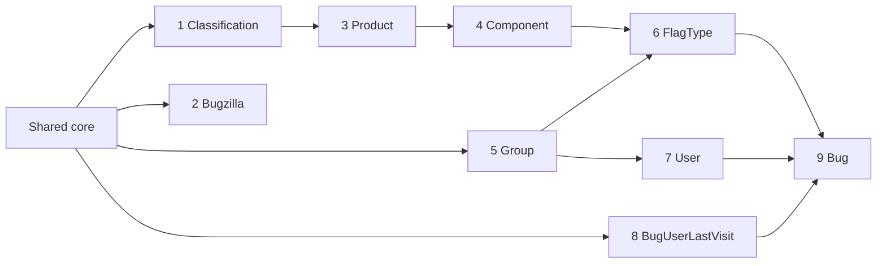

# Bugzilla Perl → Python migration plan (strangler pattern)

Companion to [ARCHITECTURE.md](ARCHITECTURE.md). Perl remains the system of record until each
slice proves parity; nothing in this plan requires a data migration or a schema change.

## 1. Goals and non-goals

**In scope (this programme):** the REST surface served by `rest.cgi` — the nine
`Bugzilla::WebService::*` modules — re-implemented in Python, cut over route-by-route behind Apache.

**Out of scope (later waves):** HTML CGIs and Template Toolkit pages, JSON-RPC/XML-RPC transports,
email (`BugMail`, `jobqueue.pl`), whines, charts, `checksetup.pl`/schema ownership, extensions.
These stay on Perl and keep working against the same database throughout.

## 2. Target architecture

```mermaid
flowchart LR
    C[Clients] --> A[Apache 2.4 :8080<br/>mod_perl + mod_proxy]
    A -->|"ProxyPass /rest.cgi/&lt;migrated&gt;*<br/>ProxyPass /rest/&lt;migrated&gt;*"| PY[bugzilla-api (Python)<br/>FastAPI + uvicorn :8000<br/>stateless container]
    A -->|everything else| PERL[Perl CGIs incl. rest.cgi<br/>for not-yet-migrated routes]
    PY -->|SQLAlchemy 2.x / PyMySQL| DB[(MariaDB<br/>same `bugs` schema)]
    PERL -->|DBI| DB
```

| Concern | Decision |
|---|---|
| Framework | FastAPI (Pydantic v2 request/response models, OpenAPI generated for free), uvicorn, Python 3.12. |
| Persistence | SQLAlchemy 2.x Core + ORM, **reflecting/declaring the existing tables** (`bugs`, `profiles`, `products`, …). No Alembic, no new tables: `checksetup.pl` stays the schema owner. Driver: PyMySQL (pure Python) or mysqlclient. |
| State | None in the process. Sessions are the existing `logincookies` rows, API keys the existing `user_api_keys` rows. Scales horizontally; no sticky routing needed. |
| Config | Read `localconfig` values from env (`BZ_DB_*`, already in `docker-compose.yml`) and `data/params.json` (mounted read-only) for runtime params such as `insidergroup`, `defaultpriority`, `urlbase`, `maxusermatches`. |
| Container | `python/Dockerfile`; compose service `bugzilla5.api` on `:8000`, `depends_on: bugzilla5.db`, same env anchor. |
| Routing | Apache `mod_proxy`: one `ProxyPass`/`ProxyPassReverse` pair per migrated path prefix in `docker/000-default.conf` (plus the `/rest/` alias). Un-migrated prefixes fall through to `rest.cgi`. Rollback = delete the `ProxyPass` line. |
| Contract | Byte-for-byte JSON parity with Perl on paths, status codes, error codes/messages, field names, type coercion (`int`/`boolean`/`dateTime`), `include_fields`/`exclude_fields`, `token`/`api_key`/`login` handling, `ETag` and CORS headers. OpenAPI is additive documentation, not a contract change. |
| Write semantics | Same tables, same side-effect rows: `audit_log`, `bugs_activity`, `bugs.delta_ts`, `bugs_fulltext`, `logincookies.lastused`, `profiles.last_seen_date`. Email: Python writes nothing to `mail_staging`/`ts_*` in wave 1 (documented gap; see §6). |
| Observability | Structured JSON logs, `/healthz`, request id header; Apache access log already covers routing. |

### Code layout (fan-out friendly: one folder per module, no shared registry edits)

```
python/
  Dockerfile  pyproject.toml
  app/
    main.py                 # creates FastAPI app, auto-discovers app.modules.*.router
    core/                   # shared, coordinator-owned
      config.py             # env + params.json
      db.py                 # SQLAlchemy engine/session, MariaDB dialect quirks
      auth.py               # token / api_key / login resolution → current user (profiles, groups)
      errors.py             # BugzillaError(code, message) + WS_ERROR_CODE table + REST_STATUS_CODE_MAP
      fields.py             # include_fields / exclude_fields filter, type helpers (bool/int/dateTime)
      models/               # SQLAlchemy table declarations shared by modules
    modules/
      <module>/router.py    # REST routes, mirrors Resources/<Module>.pm
      <module>/service.py   # business logic ported from WebService/<Module>.pm + domain .pm
      <module>/schemas.py   # Pydantic models
parity/
  conftest.py normalize.py  test_<module>.py   # black-box tests, BASE_URL-driven
Makefile                     # make parity TARGET=perl|python
```

## 3. Shared core (built once, before the fan-out)

The core is the only place children may not edit. It must cover what every module needs:

1. **Auth** — accept `token` (`<userid>-<logincookie>`), `api_key` / `X-BUGZILLA-API-KEY`,
   `login`+`password` (body, and query-string on `GET /login` only), browser cookies
   `Bugzilla_login`+`Bugzilla_logincookie`; `bz_crypt` SHA-256 verification; lockout rules;
   `LOGIN_EXEMPT`/optional/required semantics; group membership resolution (`user_group_map` +
   `group_group_map` closure); `can_see_bug`, `can_enter_product`, `in_group` helpers.
2. **Errors** — raise `BugzillaError('bug_id_does_not_exist', bug_id=…)` and get the exact Perl
   message text (ported from `template/en/default/global/{user,code}-error.html.tmpl`) and code.
3. **Response shaping** — `include_fields`/`exclude_fields`, `_default/_all/_custom/_extra`, typed
   scalars, `dateTime` as `…Z`, scalar → `{"result": …}`, `ETag`, CORS, JSONP `callback`.
4. **DB** — session per request, `bugs.delta_ts`/`lastdiffed` helpers, `audit_log` writer,
   `bugs_activity` writer, `bugs_fulltext` sync.
5. **Params** — `params.json` reader with Perl defaults.

A thin reference module (**Classification**: one `GET`, read-only, 3 tables) is implemented
alongside the core to prove the pattern end to end before anything is parallelised.

## 4. Migration units

Sizes are Perl LOC of `WebService/<M>.pm` + `Resources/<M>.pm` + the share of domain code the
methods reach. Risk reflects write paths, authorization logic and hidden coupling.

| # | Unit | Routes | Perl LOC (WS / domain reached) | Risk | Depends on | Notes |
|---|---|---|---|---|---|---|
| 1 | **Classification** | 1 | 275 / ~300 (`Classification.pm`) | Low | core | Read-only; needs product visibility rules from core. Reference implementation. |
| 2 | **Bugzilla** | 6 | 576 / ~100 | Low | core | `version`, `time`, `timezone`, `extensions` (reads `extensions/` dir), `last_audit_time`, `parameters` (admin-filtered `params.json`). Trivially parallel. |
| 3 | **Product** | 5 (incl. 3 list variants) | 1035 / ~1200 (`Product.pm`, `Version.pm`, `Milestone.pm`) | Medium | 1 | `create`/`update` write `products`, `versions`, `milestones`, `group_control_map`, optional `series`. Needs `editcomponents` group. |
| 4 | **Component** | 1 | 196 / ~700 (`Component.pm`) | Low–Med | 3 | `create` only; validates default assignee/QA/CC against `profiles`, writes `component_cc`. |
| 5 | **Group** | 3 | 670 / ~730 (`Group.pm`) | Medium | core | `get` has three modes (ids/names, `membership`, admin-all); `create`/`update` need `creategroups`; `is_bug_group`, `icon_url`, regexps. |
| 6 | **FlagType** | 4 | 915 / ~800 (`FlagType.pm`) + `Flag.pm` read side | Medium | 3, 4, 5 | Inclusions/exclusions per product/component, grant/request groups, `sortkey`/`is_requesteeble`/`is_multiplicable`. |
| 7 | **User** | 5 | 1175 / ~1500 of `User.pm` + `Auth/*` | High | core, 5 | `login`/`logout`/`valid_login` are the auth core exposed as routes; `get` has `match` (LIKE search, `maxusermatches`), `groups`/`saved_searches`/`saved_reports` sub-objects only for self; `create` hashes passwords with `bz_crypt`, sends mail; `update` writes `profiles_activity`. |
| 8 | **BugUserLastVisit** | 2 | 259 / ~100 + `Bug->check` | Low–Med | core (bug visibility) | Small, but `update` with no `ids` marks *all* visited bugs — cheap canary for the bug-visibility helper. |
| 9 | **Bug** | 14 | 4871 / ~8000+ (`Bug.pm`, `Comment.pm`, `Attachment.pm`, `Flag.pm`, `Search.pm`, `Field.pm`) | **Very high** | 3, 4, 5, 6, 7 | Split internally: (a) `fields`/`legal_values`, (b) `get`/`comments`/`history`/`attachments` reads, (c) `create`/`update`/`add_comment` writes with `bugs_activity`, `cc`, `dependencies`, `duplicates`, `keywords`, status workflow validation, (d) `search` over `Bugzilla::Search`, (e) attachments write (`attach_data`, base64, flags), (f) comment tags. Email side effects deferred. |

### Order



* **Wave 0 (serial, coordinator):** core + Classification; parity harness green against Perl for
  *every* module first (tests exist before code).
* **Wave 1 (parallel, one child session each):** Bugzilla, Product, Group, BugUserLastVisit, then
  Component (after Product), FlagType (after Component+Group), User (after Group). Children branch
  from `migration/python`, edit only `python/app/modules/<module>/` and `parity/test_<module>.py`,
  and escalate any `core/` change to the coordinator.
* **Wave 2:** Bug, itself split into the six sub-slices above; `search` last and possibly kept on
  Perl longer (route `GET /bug` with query params can be proxied separately from `GET /bug/{id}`).
* Merge order into `migration/python`: Classification → Product → Component → Group/Bugzilla/BugUserLastVisit → FlagType → User → Bug,
  rerunning the full parity suite against Python after every merge.

### Cut-over per unit

1. Parity tests for the unit are green against Perl (`make parity TARGET=perl`).
2. Python implementation reaches the same pass count (`make parity TARGET=python`).
3. Add the `ProxyPass` line(s); run the suite through Apache (`TARGET=proxied`) so both halves are
   exercised in one process graph — the proxied suite must match Perl exactly.
4. Spot-check the HTML UI reads data written by Python (e.g. `show_bug.cgi` for a bug created via the
   Python `POST /bug`), since Perl and Python share rows.
5. Keep the Perl route reachable at `/rest.cgi/…` behind an `X-BZ-Backend: perl` header or a
   second vhost for A/B diffing in production; remove once the slice has soaked.

## 5. Parity strategy

Black-box HTTP contract tests, the single source of truth for "done":

* `parity/` is a pytest + httpx suite parameterised by `BASE_URL` (default
  `http://127.0.0.1:8080/rest.cgi`). The same tests run against Perl (`…:8080/rest.cgi`), Python
  directly (`…:8000`), and Apache-proxied (`…:8080/rest.cgi` after `ProxyPass`).
* Each test file `parity/test_<module>.py` covers every REST route of its module: happy path,
  `include_fields`/`exclude_fields`, anonymous vs. token vs. api_key, permission denial (401/code 102/410),
  not-found (404/51/101), validation errors (400 with the Perl error code and message), and write
  side effects verified through subsequent reads (`history`, `audit_log` via `last_audit_time`,
  `show_bug.cgi` smoke).
* Fixtures come from `scripts/seed_demo_data.py` (idempotent, alias-keyed `seed-NN` bugs) so both
  backends see identical data; write tests create their own objects with unique names and clean up.
* **Normalisation only in `parity/normalize.py`**: timestamps (`creation_time`, `last_change_time`,
  `when`), tokens, auto-increment ids, `ETag`, ordering of unordered lists. Everything else is
  compared verbatim. The golden value is the *live Perl response*, not a stored snapshot, so
  drift in Perl is caught as well.
* Optional "diff mode": `parity/diff.py` replays a recorded request log against both base URLs and
  prints a JSON diff — used for exploratory gaps and for the production A/B soak.
* `make parity TARGET=perl|python|proxied`; GitHub Actions job: `docker compose up -d --build`
  (web+db+api), seed, run `TARGET=perl` and `TARGET=python`, fail if Python's pass count is below Perl's
  for any merged module. Results table (endpoint | Perl | Python) is posted on each module PR.

## 6. Known gaps, risks and mitigations

| Risk | Mitigation |
|---|---|
| `Bug.search` SQL semantics (boolean charts, quicksearch, custom fields, `bugs_fulltext`) | Port last; start with the parameter subset used by clients (`product`, `component`, `status`, `assigned_to`, `summary`, `last_change_time`, `limit/offset`); keep Perl behind the proxy for unsupported combos and return the Perl error for unknown params until full coverage. |
| Email side effects on `Bug.create/update`, `User.create` | Wave 1: Python does not send mail. Either call back into Perl (`jobqueue.pl` consumes `ts_job` rows the Python side inserts) or accept the gap for the demo; documented per PR. |
| Error message text lives in Template Toolkit (`user-error.html.tmpl`) | Port the ~40 messages the REST paths can raise into `core/errors.py`; parity tests assert `code` and `message`. |
| `Field::Choice` runtime tables and `cf_*` custom fields | Reflect `fielddefs` at startup; model choice tables generically. |
| Taint-mode/validation quirks (`detaint_natural`, trimming, `--` default priority) | Pydantic validators mirror `VALIDATORS` in each `Object` subclass; parity error cases pin the behaviour. |
| Password hashing/lockout differences | Reuse `bz_crypt` algorithm exactly; tests for correct password, wrong password ×5 → lockout code. |
| Shared-row concurrency between Perl and Python | Both use row-level InnoDB writes and the same `delta_ts` convention; no in-process caches in Python (Perl's memcached is off in this deployment). |
| Timezone | `TZ=Etc/UTC` in both containers; all `dateTime` output in UTC with `Z`. |

## 7. Definition of done for a module PR (what each child session delivers)

1. `parity/test_<module>.py` green against Perl **before** any Python is written.
2. `python/app/modules/<module>/{router,service,schemas}.py`, no edits outside that folder and its test file.
3. `make parity TARGET=python` green for the module *and* for every previously merged module.
4. `ProxyPass` rule for the module's path prefixes added to `docker/000-default.conf`.
5. PR into `migration/python` with the Perl-vs-Python table (endpoint | Perl | Python), LOC before/after, and
   any core change requests listed for the coordinator.
