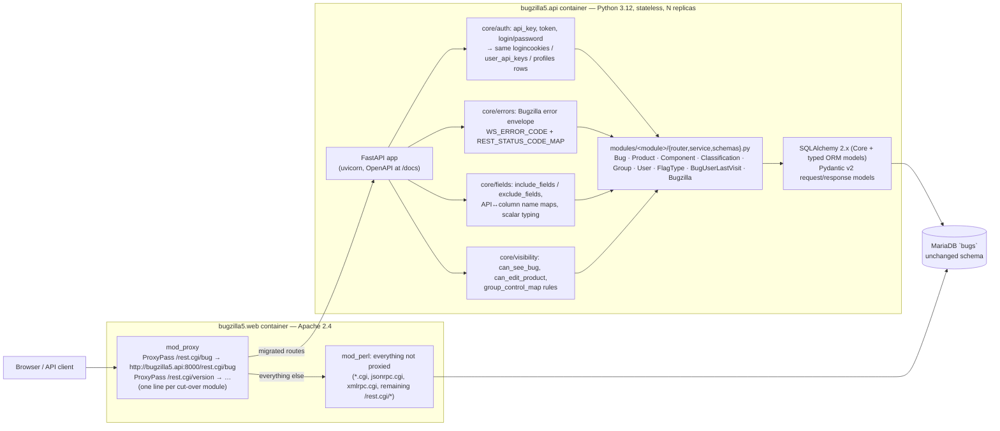
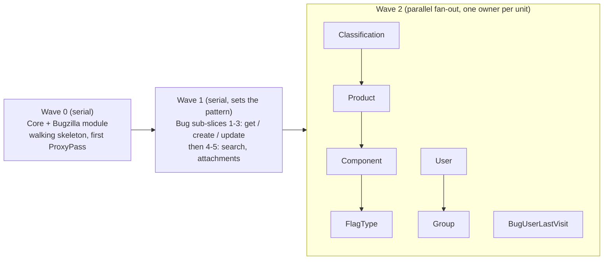

# Bugzilla 5.2 — Perl → Python migration plan

Status: **proposal, phase 1 (no Python written yet)**. Read [ARCHITECTURE.md](ARCHITECTURE.md) first.

## 1. Principles

1. **Strangler pattern.** Perl stays live and is the source of truth. Apache keeps serving every URL;
   routes are moved to Python one WebService module at a time by adding a `ProxyPass` rule, and moved
   back by deleting it.
2. **Same database, no data migration.** The Python service reads and writes the existing MariaDB
   schema (`Bugzilla/DB/Schema.pm`, 90 tables) with the exact same semantics (`bugs_activity`, `audit_log`,
   `delta_ts`, `logincookies`, …) so Perl pages such as `show_bug.cgi` and `buglist.cgi` render whatever
   the API wrote, and vice versa.
3. **Parity before cut-over.** A route is proxied to Python only when the black-box contract suite for
   its module passes 100% against the Perl base URL *and* the Python base URL.
4. **REST only.** HTML CGIs, JSON-RPC/XML-RPC, bug mail delivery, whines, charts and `checksetup.pl`
   stay in Perl for the foreseeable future. They are listed as "later waves" at the end.

## 2. Target architecture



### 2.1 Service design

| Concern | Decision |
| --- | --- |
| Framework | FastAPI (Pydantic v2 models, generated OpenAPI). One `APIRouter` per module under `python/app/modules/<module>/router.py`, auto-discovered at startup so parallel work does not collide on a registry file. |
| Persistence | SQLAlchemy 2.x. Hand-written typed ORM models for the tables a module touches (see ARCHITECTURE §4); SQLAlchemy Core for the search builder (`Bug.search`). Pool via `mysqlclient`/`PyMySQL`; one `Session` per request; `READ COMMITTED` like Perl's `DBD::MariaDB` default. No Alembic — the schema is owned by `checksetup.pl`; a startup check asserts the expected tables/columns exist. |
| Statelessness | No in-process caches for correctness. Session = `logincookies` row (as today). Optional read-through cache (memcached params) only for `fielddefs`/`products`/`groups` with TTL ≤ 60 s, off by default. |
| Auth | `core/auth.py` reproduces `Bugzilla::Auth` for web services: `api_key`/`Bugzilla_api_key` → `user_api_keys`; `token`/`Bugzilla_token` → `logincookies`; `login`+`password` → `profiles.cryptpassword` (`bz_crypt` salted SHA-256) with `login_failure` lockout bookkeeping; GET requests refuse cookie login except `/login`; `X-Bugzilla-*` headers are **not** added (not in 5.2). Anonymous user model with the same group resolution (`user_group_map` + regexp groups + `group_group_map`). |
| Errors | `core/errors.py`: a `BugzillaError(name, **vars)` exception, a table copied from `WS_ERROR_CODE`, messages rendered from the same wording as `template/en/default/global/user-error.html.tmpl` / `code-error.html.tmpl` (text only), and `REST_STATUS_CODE_MAP` for the HTTP status. Unhandled exceptions → code `100500`, HTTP 200 **behind a flag** (`BZ_COMPAT_DIE_200=1` during parity, `0` after cut-over). |
| Response shaping | `core/fields.py`: `include_fields`/`exclude_fields` with `_default/_all/_custom/_extra`, JSON scalar typing identical to `WebService::type()` (ints as ints, booleans as booleans, dates as `YYYY-MM-DDTHH:MM:SSZ`), ETag = base64 MD5 of the JSON body, `If-None-Match` → 304, `Access-Control-Allow-Origin: *`. |
| Side effects | `core/activity.py` writes `bugs_activity`, `audit_log`, `bugs.delta_ts`, `bugs_fulltext`; `core/mail.py` renders the same notification set as `Bugzilla::BugMail` (recipient resolution via `email_setting`, watchers, `email_bug_ignore`) and sends via the configured `mail_delivery_method` (`Test` → append to the shared `data/mailer.testfile` volume, `SMTP`, `None`). Ported with the Bug unit; see risk R1. |
| Extensions / hooks | Not ported. Any in-tree extension that alters REST behaviour would be re-implemented as a FastAPI dependency; none of the shipped extensions touch the REST modules. |
| Config | Reads `data/params.json` from the shared `bugzilla5-data-dir` volume (read-only) so `maintainer`, `requirelogin`, `defaultpriority`, `useclassification`, `mail_delivery_method`, etc. stay single-sourced in Perl's admin UI. DB credentials from env (`BZ_DB_*`, same names as docker-compose). |
| Packaging | `python/Dockerfile` (python:3.12-slim, non-root), `bugzilla5.api` service in docker-compose on `:8000` sharing `bugzilla5.db` and the data volume. Health: `GET /healthz` (DB ping + params readable). Structured JSON logs with request id. |
| Quality gates | `ruff`, `mypy --strict` on `python/app/core`, unit tests for validators, and the parity suite (§4). |

### 2.2 Apache cut-over mechanics

```apache
# docker/000-default.conf (added when a module reaches parity)
ProxyPreserveHost On
ProxyPass        /rest.cgi/version   http://bugzilla5.api:8000/rest.cgi/version
ProxyPassReverse /rest.cgi/version   http://bugzilla5.api:8000/rest.cgi/version
# Bug module (regex because /bug, /bug/{id}, /bug/{id}/comment, /bug/attachment/… all belong to it)
ProxyPassMatch   ^/rest\.cgi/(bug|field/bug)(/.*)?$  http://bugzilla5.api:8000/rest.cgi/$1$2
```

* `.htaccess` keeps rewriting `/rest/...` → `/rest.cgi/...`, so both URL styles are covered by one rule.
* Rollback = remove the rule and `apachectl graceful`. No data changes to undo because both sides write
  the same tables.
* Requires `a2enmod proxy proxy_http` in the Dockerfile (added with the first cut-over).
* The Python app mounts its routers under `/rest.cgi` so the proxied path needs no rewriting and the
  parity suite can use the same relative paths for both base URLs.

## 3. Migration units

Size counts Perl lines the unit has to understand: the WebService module plus the domain code it is the
*first* to need (shared code is attributed to the first unit that ports it). Risk is about behavioural
subtlety and blast radius, not size.

| # | Unit (WebService module) | REST routes | Perl LOC to port (WS + newly needed domain) | Tables (R/W) | Size | Risk | Depends on | Notes |
| --- | --- | --- | --- | --- | --- | --- | --- | --- |
| 0 | **Core** (not a module) | — | `WebService.pm` 414, `WebService/Util.pm` 382, `WebService/Constants.pm` 346, `Server/REST.pm` ~600, `Auth/**` ~1,400, `Object.pm` 1,594 (generic CRUD/audit), `User.pm` permission subset ~1,200 | `profiles`, `user_group_map`, `group_group_map`, `groups`, `logincookies`, `user_api_keys`, `login_failure`, `tokens`, `audit_log`, `fielddefs` | L | **High** | — | Auth, error envelope, field filtering, visibility, activity/audit writers. Everything else is blocked on it, so it is built alongside unit 1 and hardened by unit 2. |
| 1 | **Bugzilla** | 6 GET | 530 | `audit_log` (R); `data/params.json` | S | Low | 0 (minimal) | Walking skeleton: proves container, proxy, params access, error envelope, parity harness. First route proxied to Python. |
| 2 | **Bug** | 20 (GET/POST/PUT) | `WebService/Bug.pm` 4,692 + `Bug.pm` 5,123 + `Search.pm` 3,561 + `Search/Quicksearch.pm` 717 + `Comment.pm` 646 + `Attachment.pm` 1,055 + `Flag.pm`/`FlagType.pm` 2,106 + `Field.pm` 1,520 + `Status.pm` 341 + `Keyword.pm` 185 + `BugUrl.pm` 218 + `BugMail.pm` 658 ≈ **20,800** | see ARCHITECTURE §4 (≈45 tables, 20 written) | **XL** | **High** | 0 | 80% of API traffic and of behavioural risk: validators per field, status workflow, dependency loops, dupes, groups, flags, attachments, comment tags, search → SQL, activity + mail. Split internally into sub-slices (see §3.1). |
| 3 | **Classification** | 1 GET | 224 + `Classification.pm` 308 | `classifications`, `products`, `group_control_map` (R) | S | Low | 0 | Pure read; good first fan-out task. |
| 4 | **Product** | 7 | 964 + `Product.pm` 1,185 + `Version.pm` 372 + `Milestone.pm` 398 + `Component.pm` read side | `products`, `components`, `component_cc`, `versions`, `milestones`, `group_control_map`, `series*` (R/W) | M | Medium | 0, 3 | `create` also seeds `series` rows; `update` must write `audit_log`/`profiles_activity`-style changes. |
| 5 | **Component** | 1 POST | 152 + `Component.pm` 686 | `components`, `component_cc` (W) | S | Low | 4 | Validates product, default assignee/QA/CC users. |
| 6 | **User** | 7 | 1,106 + remaining `User.pm` (~2,200), `User/Setting.pm` 449, `Token.pm` 692 | `profiles`, `profiles_activity`, `user_group_map`, `logincookies`, `login_failure`, `tokens`, `email_setting`, `profile_setting` (R/W) | L | **High** | 0 | `GET /login` must mint `logincookies` rows that Perl accepts, and vice versa; `create`/`update` touch password hashing, `editusers` bless rules, `offer_account_by_email` sends mail (JSON-RPC only; skipped). |
| 7 | **Group** | 3 | 613 + `Group.pm` 732 | `groups`, `group_group_map`, `user_group_map`, `group_control_map` (R/W) | M | Medium | 0, 6 (membership) | `get` with `membership` resolves users; `create` adds the group to product controls. |
| 8 | **FlagType** | 4 | 846 + `FlagType.pm` 797 (shared with 2) | `flagtypes`, `flaginclusions`, `flagexclusions` (R/W) | M | Medium | 4, 5 | Inclusion/exclusion matrix per product/component; `update` renames must not orphan `flags`. |
| 9 | **BugUserLastVisit** | 2 | 206 + 95 | `bug_user_last_visit` (R/W) | S | Low | 2 (bug visibility) | Trivial once Bug visibility exists. |

### 3.1 Bug unit sub-slices (deliver in this order, each parity-gated)

1. `GET /bug/{id}`, `GET /bug` (ids/alias only), `GET /bug/{id}/comment`, `GET /bug/{id}/history`,
   `GET /bug/{id}/attachment` metadata, `GET /field/bug*` — read model, visibility, field typing.
2. `POST /bug`, `POST /bug/{id}/comment` — create path, validators, defaults, activity, mail.
3. `PUT /bug/{id}` — field updates, `{add,remove,set}` lists, status/resolution workflow, dupes,
   dependency loop detection, mid-air `delta_ts`.
4. `GET /bug` full search (`Bugzilla::Search` port: field operators, `quicksearch`, `order`, `limit`).
5. Attachments (`POST`/`PUT`, base64 data, flags) and comment tags.

### 3.2 Order and waves



Why Bug before the small modules: it is where the shared core (visibility, activity, field maps, mail)
gets exercised for real, so the fan-out units inherit a proven core instead of each discovering gaps.
Classification/Product/Component form a dependency chain and are the natural first parallel track.

### 3.3 Definition of done per unit

1. `parity/test_<module>.py` exists and is green against **Perl** (`make parity TARGET=perl`).
2. `python/app/modules/<module>/` implemented; `make parity TARGET=python` green for this module *and*
   all previously cut-over modules.
3. Diff mode (§4.3) shows zero normalised differences on the seeded dataset.
4. `ProxyPass` rule added; `show_bug.cgi`/`buglist.cgi` render objects created through Python.
5. PR into the long-lived `migration/python` branch with the Perl-vs-Python table; `docs/migration/STATUS.md` row updated.

## 4. Parity strategy

### 4.1 Harness

* `parity/` — pytest + httpx. `BASE_URL` selects the target (`http://127.0.0.1:8080/rest.cgi` for Perl,
  `http://127.0.0.1:8000/rest.cgi` for Python). Both run against the **same** MariaDB and the same
  seed (`scripts/seed_demo_data.py`), so the fixtures are identical.
* Each test creates what it needs with unique aliases/names (`parity-<uuid>`) and never depends on
  earlier tests, so the suite can run against either target in any order and repeatedly.
* Contract tests are black-box: they only know URLs, JSON bodies, status codes and headers. No imports
  from the Python app.

### 4.2 What is asserted

| Category | Examples |
| --- | --- |
| Happy path shape | key set, scalar types (`int` vs `str`), date format, `include_fields`/`exclude_fields` behaviour, 201 vs 200 |
| Auth matrix | anonymous / `api_key` / `token` / `login+password` × GET/POST/PUT; GET refuses cookie-style auth; revoked key → 306; bad token → 401 |
| Error contract | every `WS_ERROR_CODE` reachable from REST for the module: unknown id → 101/404, alias in use → 103, missing `priority` → 50, illegal status transition → 123, dependency loop → 116, `requirelogin` → 410 |
| Side effects | `GET /bug/{id}/history` after an update shows the same `changes` rows (field, removed, added, who); `last_audit_time` moves; `bugs.delta_ts` changes; `data/mailer.testfile` gains the same number of mails per change (soft check, R1) |
| Cross-engine consistency | object created via Python readable via Perl and rendered by `show_bug.cgi`; and the reverse |
| Non-functional | p95 latency of Python ≤ 2× Perl on `GET /bug/{id}` and `GET /bug?product=` over the seed |

### 4.3 Normalisation and diff mode

Volatile values are normalised in exactly one place (`parity/normalize.py`): timestamps → `<ts>`,
auto-increment ids → `<id>` (with a stable per-test mapping so cross-references still line up), tokens,
ETags, `documentation` URLs, and ordering of unordered lists (`cc`, `groups`, `keywords`). A `--diff`
mode runs each request against both base URLs and asserts the normalised bodies are byte-identical;
differences are printed as a JSON diff and become either a fix or a documented, intentional deviation in
`docs/migration/DEVIATIONS.md`.

### 4.4 CI

* GitHub Actions job `parity-perl`: `docker compose up -d --build`, wait for `Checksetup completed.`,
  run the seed, `make parity TARGET=perl`. Required to be green on every PR — it guards the *contract*,
  not the port.
* `parity-python`: same, plus the `bugzilla5.api` service, `TARGET=python` and `--diff`. Required for any
  PR that touches `python/` or `docker/000-default.conf`.
* Perl's existing `runtests.pl` (`t/*.t`) keeps running unchanged.

## 5. Risks and open decisions

| # | Risk / decision | Mitigation |
| --- | --- | --- |
| R1 | **Bug mail** is a side effect of the Bug unit and Perl's `BugMail.pm` (658 LOC + templates) is template-driven. | Port recipient resolution exactly; render mails from a Python template that reproduces `template/en/default/email/bugmail.txt.tmpl`. Parity compares recipient sets and counts, not bodies, until the templates are ported. |
| R2 | `Bugzilla::Search` is a 3.5k-line SQL generator with operator semantics that differ per field type. | Port incrementally (sub-slice 4) behind the parity suite's search matrix; keep Perl for `buglist.cgi` so only the REST subset of operators is needed. |
| R3 | Permission semantics (`group_control_map` `membercontrol/othercontrol`, `canedit`, `strict_isolation`, insider group for private comments). | Implemented once in `core/visibility.py`, with table-driven unit tests derived from the Perl `t/` and `xt/search.t` expectations plus negative parity tests using the seeded users. |
| R4 | Replicating Perl quirks (HTTP 200 for `100500` errors, JSONP, `text/html` Accept) may lock in bad behaviour. | Behind `BZ_COMPAT_*` flags, on during parity, off at cut-over; each flagged quirk listed in `DEVIATIONS.md`. |
| R5 | Both engines writing the same tables concurrently (e.g. Perl `process_bug.cgi` and Python `PUT /bug`). | Same row-level semantics (`delta_ts` mid-air check, transactions per request); no caches on the Python side; parity runs cross-engine create/read tests. |
| R6 | Password/API-key formats must stay byte-compatible (`bz_crypt` SHA-256 + salt + `{SHA-256}` suffix, `user_api_keys` plain compare). | Golden tests with hashes produced by the Perl container. |
| R7 | Extensions/hooks (customer deployments may rely on them). | Out of scope; documented. A FastAPI dependency-injection seam is left at the same points (`before_call`, `fix_credentials`, `error_codes`). |
| R8 | Time zones: Perl stores local DB time and the container runs UTC after PR #2. | Python and MariaDB pinned to UTC; parity asserts `GET /time` fields agree. |
| D1 | Python DB driver: `mysqlclient` (C, fastest) vs `PyMySQL` (pure Python, simpler image). | Default `PyMySQL`; switch if the latency gate in §4.2 fails. |
| D2 | Where does `migration/python` get merged? | Long-lived branch, squashed into `5.2` only when every REST route is proxied (wave 2 done). |

## 6. Later waves (not in this plan's scope)

1. **HTML CGIs**: candidates for a separate UI strategy (keep Perl, or a new SPA on top of the REST
   API once it is fully in Python). `buglist.cgi`/`show_bug.cgi` are the heaviest.
2. **JSON-RPC / XML-RPC** (`jsonrpc.cgi`, `xmlrpc.cgi`): thin adapters over the same modules; can be
   added to FastAPI once the REST modules exist, or deprecated.
3. **Batch**: `jobqueue.pl` (TheSchwartz), `whine.pl`, `collectstats.pl`, `email_in.pl` → Python
   workers reading the same tables.
4. **Install/upgrade**: `checksetup.pl` + `Bugzilla/Install/*` + `DB/Schema.pm` → Alembic, only once no
   Perl code remains.

## 7. Immediate next steps (phase 2, pending approval of this plan)

1. `parity/` harness + `test_bugzilla.py` + `test_bug.py` (read paths, auth matrix, error contract), green
   against Perl; CI job `parity-perl`.
2. `python/` skeleton with core auth/errors/fields, Bugzilla module, docker service, first `ProxyPass`.
3. Bug sub-slices 1–3.
